# Data Mining Assignment 1：Association Rules & Frequent Itemset

- 課程：資料探勘（7761）
- 學號：5115056022
- 姓名：邱勇嘉

---

## 0. 環境與資料前處理

### 0.1 環境

| 項目 | 版本或規格 |
|---|---|
| Weka | 3.9.7 |
| Java | OpenJDK 25.0.2 LTS（Weka 安裝檔內建） |
| Python | 3.11.9（用 `sqlite3` 轉檔） |
| CPU | AMD Ryzen 7 5800X（8 核 16 執行緒） |
| 作業系統 | Windows 11 Pro |

### 0.2 資料庫結構

**recipe.db**：一個國家一張表，每張表只有 `(recipe_name, ingredient)` 兩個欄位，一列就是「某道食譜用到的一項食材」

| 資料表 | 列數 | 食譜數 | 不同食材數 |
|---|---|---|---|
| Italian | 72,959 | 6,560 | 2,398 |
| Thai | 11,779 | 952 | 879 |

**foodmart.db**：零售業的星狀綱要（star schema），本作業用到下面這些表

| 資料表 | 列數 | 用途 |
|---|---|---|
| customer | 10,281 | 第 4 題：顧客基本資料 |
| sales_fact_1998 | 164,558 | 第 5 題：1998 年 1～11 月的銷售 |
| sales_fact_dec_1998 | 18,325 | 第 5 題：1998 年 12 月的銷售 |
| product、product_class | 1,560、110 | 第 5 題：把商品對應到類別 |
| time_by_day | 730 | 第 5 題：日期 |

### 0.3 前處理原則

- **讀取方式**：用 Python 的 `sqlite3` 直接連資料庫，用 SQL 查詢後轉成 ARFF
- **交易的定義**：用 `GROUP BY recipe_name` 分組，一個食譜名稱算一筆交易
  照題目「整理每一道食譜」的意思直接處理，不做額外的資料清理或最佳化
- **同一道食譜重複列的食材**：Italian 有 7,795 列、Thai 有 1,023 列重複，例如同一種食材在不同步驟各用一次（"KILLER" Lasagna 有兩列 salt）
  ARFF 是每種食材一個屬性，值只有「有」或「缺」，所以同一筆交易裡重複的食材自然只記一次
- **同名食譜**：資料表沒有食譜 ID，`recipe_name` 多半是通用的菜名或菜色類別，不同做法的食譜會用同一個名稱
  例如 'Antipasto' 是義式套餐的第一道前菜，內容依地區和做法而不同，資料裡就有一段是醃漬蔬菜、另一段是冷肉和起司；'Chicken Cacciatore'（獵人風味燉雞）是一種做法，資料裡分成 23 段，用的雞肉部位和配料都不一樣
  照資料列的順序看，同名的列分散在好幾段不連續的區段，每段的食材都不一樣
  用名稱分組會把這些不同的食譜合成一筆

  | 資料表 | 用名稱分組（本報告採用） | 依連續區段分組 | 分散成多段的名稱數 |
  |---|---|---|---|
  | Italian | 6,560 | 7,005 | 210 |
  | Thai | 952 | 1,002 | 31 |

  本報告照題意用名稱分組

  註：段數是用下面的 SQL 照資料列的順序（rowid）算出來的，前一列名稱不同就算新的一段：

  ```sql
  WITH r AS (
    SELECT recipe_name, LAG(recipe_name) OVER (ORDER BY rowid) AS prev FROM Italian
  )
  SELECT recipe_name, COUNT(*) AS segments FROM r
  WHERE prev IS NULL OR prev <> recipe_name
  GROUP BY recipe_name;
  -- Antipasto 2 段、Chicken Cacciatore 23 段
  ```
- **ARFF 格式**：一般的非稀疏格式，每種食材一個屬性（Italian 有 2,398 個），型別是只有一個值的 `{t}`
  用到的食材記 `t`，沒用到的記成缺值 `?`
  - **為什麼用 `?`**：Weka 的 Apriori 和 FPGrowth 會把每個「屬性 = 值」當成一個 item，缺值不算 item
    所以一道食譜轉成交易後，item 只有它實際用到的食材
    以 Table 1 的 Triple Chocolate Biscotti 為例，這筆交易剛好是 9 個 item，和題目的定義一致
  - **如果改用 `{f,t}` 或 0/1**：沒用到的食材也會變成 item（例如 `salt=f`），每筆交易都會有 2,398 個 item，不符合題目的定義
  - **語意說明**：ARFF 的 `?` 原本表示「不知道」，這裡當成「沒有這項食材」
    這是購物籃資料常用的寫法，Weka 附的範例 `supermarket.arff` 也是這樣寫

### 0.4 共同的 Weka 參數

- 各題的參數表只列有改過或和題目有關的參數，沒列出的都用 Weka 預設值：

  | 參數 | 預設值 | 說明 |
  |---|---|---|
  | metricType | Confidence | 用信賴度當門檻和排序依據 |
  | delta | 0.05 | 每個 cycle 支持度降低的幅度 |
  | upperBoundMinSupport | 1.0 | 支持度從這裡開始往下降 |

- 每題另外附「實際執行的指令」，是 Weka 記錄的完整參數

---

## Compare Apriori and FPGrowth

### Question 1-1　Apriori（min_sup = 0.005，min_conf = 0.9）

**回答**

- Weka 正常跑完，沒有出現錯誤訊息，執行了 **516 秒（8 分 36 秒）**
- 信賴度最高的前 10 條規則見下方「結果」，10 條的信賴度都是 1，後件只有 garlic 和 salt
- 和 FPGrowth 的比較放在 1-2 最後

**操作**

1. 用 `scripts/make_recipe_arff.py` 把 `Italian` 表依 `recipe_name` 分組，產生 `arff/italian.arff`
   一道食譜是一筆交易、一項食材是一個 item，共 6,560 筆交易、2,398 個屬性，平均每道食譜 9.93 種食材
2. Weka Explorer → Preprocess → Open file，載入 `italian.arff`
3. Associate → Choose → `weka.associations.Apriori`，只把 `lowerBoundMinSupport` 改成 0.005，其他用預設值：

| 參數 | 值 | 說明 |
|---|---|---|
| lowerBoundMinSupport | **0.005** | 最小支持度（題目指定） |
| minMetric | **0.9** | 最小信賴度（題目指定，剛好也是預設值） |
| numRules | 10 | 預設，列出 10 條規則 |

實際執行的指令：`weka.associations.Apriori -N 10 -T 0 -C 0.9 -D 0.05 -U 1.0 -M 0.005 -S -1.0 -c -1`

**結果**

Weka 輸出的摘要：

- `Minimum support: 0 (33 instances)`：Weka 只顯示到小數第二位，所以 0.005 顯示成 0，實際門檻是 6,560 × 0.005 ≈ 33 筆
- `Number of cycles performed: 20`：支持度從 0.95 開始每次降 0.05，降到 0.005 才湊滿 10 條信賴度 ≥ 0.9 的規則
- 頻繁項目集：L(1) 264、L(2) 1,561、L(3) 2,970、L(4) 2,578、L(5) 975、L(6) 117、L(7) 1

信賴度最高的前 10 條規則（支持度 = 支持數 ÷ 6,560，Weka 畫面見圖 1-1）：

| # | 規則 | 支持數 | 支持度 | 信賴度 | Lift |
|---|---|---|---|---|---|
| 1 | basil, onion, parsley, salt ⇒ garlic | 53 | 0.0081 | 1 | 1.94 |
| 2 | pepper, tomato, tomato sauce ⇒ salt | 49 | 0.0075 | 1 | 2.63 |
| 3 | garlic, parmesan cheese, pepper, tomato sauce ⇒ salt | 43 | 0.0066 | 1 | 2.63 |
| 4 | garlic, pepper, tomato, tomato sauce ⇒ salt | 43 | 0.0066 | 1 | 2.63 |
| 5 | red pepper flake, salt, tomato sauce ⇒ garlic | 42 | 0.0064 | 1 | 1.94 |
| 6 | basil, onion, parmesan cheese, tomato paste ⇒ garlic | 42 | 0.0064 | 1 | 1.94 |
| 7 | olive oil, parsley, pepper, tomato ⇒ salt | 41 | 0.0063 | 1 | 2.63 |
| 8 | garlic, oregano, pepper, tomato sauce ⇒ salt | 40 | 0.0061 | 1 | 2.63 |
| 9 | basil, parmesan cheese, salt, tomato paste ⇒ garlic | 39 | 0.0059 | 1 | 1.94 |
| 10 | basil, olive oil, onion, parsley, salt ⇒ garlic | 39 | 0.0059 | 1 | 1.94 |

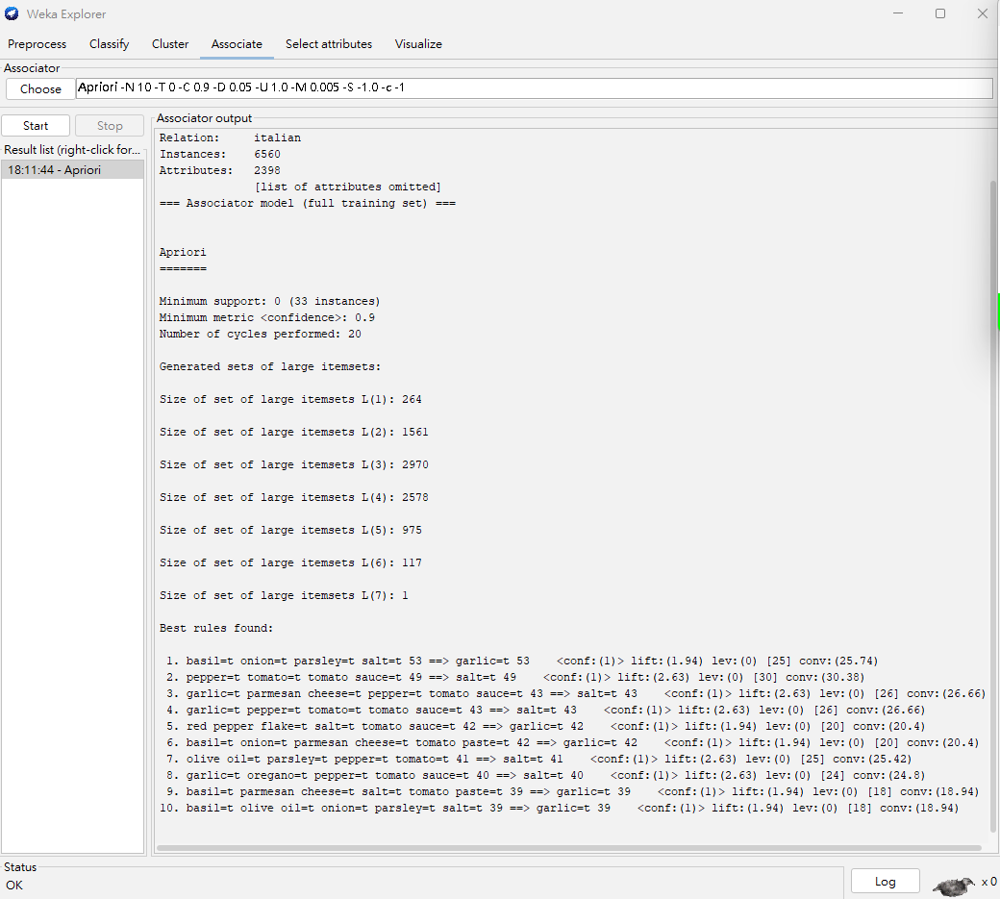
圖 1-1　Apriori 的 Weka 輸出（前 10 條規則）

**效果解釋**

- 10 條規則的信賴度都是 1：只要前件的食材都出現，後件就一定會出現
- 後件只有 **garlic** 和 **salt** 兩種，都是義式料理最基本的調味料
  - Lift = 信賴度 ÷ 後件的支持度，所以 garlic 的 lift 1.94 代表約 51.5% 的義式食譜有用 garlic，salt 的 lift 2.63 代表約 38%
  - 前件多是番茄類（tomato、tomato sauce、tomato paste）和香草（basil、parsley、oregano），也就是說，做番茄醬汁或香草料理時，garlic 和 salt 幾乎必放
- 支持數只有 39～53 筆，大約占全部食譜的 0.6%～0.8%
  這些是低支持度、高信賴度的規則，要把 min_sup 設到 0.005 這麼低才找得到

---

### Question 1-2　FPGrowth（min_sup = 0.005，min_conf = 0.9）

**回答**

- Weka 正常跑完，沒有出現錯誤訊息，執行約 **1 秒**
- 信賴度最高的前 10 條規則見下方「結果」，一樣全部信賴度 1、後件只有 garlic 和 salt，但和 1-1 列出的 10 條不完全相同
- 和 Apriori 比：FPGrowth 只跑約 1 秒，Apriori 要 516 秒（見最後的比較表）

**操作**

1. 用和 1-1 相同的 `arff/italian.arff`
2. Associate → Choose → `weka.associations.FPGrowth`，一樣只把 `lowerBoundMinSupport` 改成 0.005，其他用預設值：

| 參數 | 值 | 說明 |
|---|---|---|
| lowerBoundMinSupport | **0.005** | 最小支持度（題目指定） |
| minMetric | **0.9** | 最小信賴度（題目指定，剛好也是預設值） |
| numRulesToFind | 10 | 預設，列出 10 條規則 |
| findAllRulesForSupportLevel | False | 預設；和 Apriori 一樣，從高支持度逐步往下降 |
| positiveIndex | 2 | 預設；本資料的屬性只有 `t` 一個值，這個參數不影響結果 |

實際執行的指令：`weka.associations.FPGrowth -P 2 -I -1 -N 10 -T 0 -C 0.9 -D 0.05 -U 1.0 -M 0.005`

**結果**

Weka 輸出 `FPGrowth found 1038 rules (displaying top 10)`：在 min_sup 0.005、min_conf 0.9 的條件下共找到 1,038 條規則，畫面列出前 10 條（見圖 1-2）

| # | 規則 | 支持數 | 支持度 | 信賴度 | Lift |
|---|---|---|---|---|---|
| 1 | olive oil, basil, penne pasta ⇒ garlic | 33 | 0.0050 | 1 | 1.94 |
| 2 | salt, basil, bay leaf ⇒ garlic | 36 | 0.0055 | 1 | 1.94 |
| 3 | salt, red pepper flake, tomato sauce ⇒ garlic | 42 | 0.0064 | 1 | 1.94 |
| 4 | parmesan cheese, red pepper flake, tomato paste ⇒ garlic | 33 | 0.0050 | 1 | 1.94 |
| 5 | onion, salt and pepper, ground beef ⇒ garlic | 38 | 0.0058 | 1 | 1.94 |
| 6 | tomato, red pepper flake, tomato sauce ⇒ garlic | 37 | 0.0056 | 1 | 1.94 |
| 7 | parsley, tomato paste, tomato sauce ⇒ garlic | 35 | 0.0053 | 1 | 1.94 |
| 8 | tomato, pepper, tomato sauce ⇒ salt | 49 | 0.0075 | 1 | 2.63 |
| 9 | basil, pepper, tomato sauce ⇒ salt | 35 | 0.0053 | 1 | 2.63 |
| 10 | garlic, olive oil, pepper, flour ⇒ salt | 34 | 0.0052 | 1 | 2.63 |

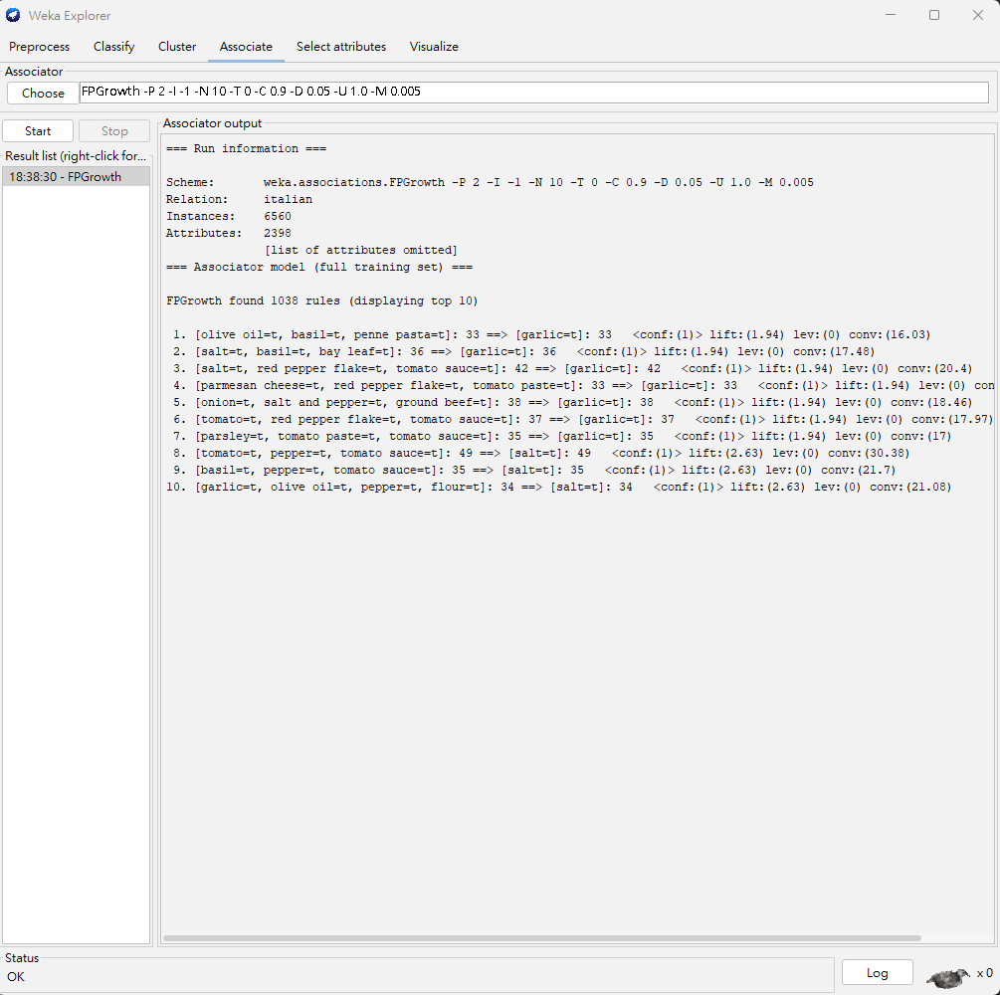
圖 1-2　FPGrowth 的 Weka 輸出（前 10 條規則）

**效果解釋**

- 和 1-1 一樣，10 條規則的信賴度都是 1，後件也只有 garlic 和 salt，反映的是同樣的食材搭配
- **兩種演算法列出的前 10 條不同**：
  - 兩邊都有的只有「tomato, pepper, tomato sauce ⇒ salt」和「salt, red pepper flake, tomato sauce ⇒ garlic」兩條
  - 原因是信賴度 1 的規則超過 10 條，光兩邊合起來就有 18 條，所以「前 10 條」裡有很多同分的規則
  - 同分時，Apriori 看起來是照支持數由大到小排（53、49、43…39），FPGrowth 則沒有照支持數排（33、36、42…）
  - 所以「前 10 條」會因演算法而不同，但每一條規則本身都符合條件

**比較 Apriori 與 FPGrowth**

| 面向 | Apriori（1-1） | FPGrowth（1-2） |
|---|---|---|
| 參數 | min_sup 0.005、min_conf 0.9，其他預設 | 相同 |
| 錯誤訊息 | 無 | 無 |
| 執行時間（Weka Log 起訖時間相減） | **516 秒（8 分 36 秒）** | **約 1 秒** |
| 輸出 | 20 個 cycles，L(1)～L(7) 共 8,466 個頻繁項目集，列出 10 條規則 | 找到 1,038 條規則，列出 10 條 |

註：「輸出」這列兩邊的數字不是同一種
Apriori 的 Weka 輸出只有頻繁項目集的數量，沒有規則總數；FPGrowth 只有規則總數，沒有頻繁項目集的數量
所以 8,466 和 1,038 不能直接比

**結論**

1. **同樣的資料和參數，FPGrowth 比 Apriori 快很多**：約 1 秒對 516 秒
2. **差別來自演算法的設計**：
   - Apriori 要一層一層產生候選項目集，每一層都要掃一次整個資料庫來算支持度
     min_sup 只有 0.005 時頻繁項目集很多（L(2) 1,561 個、L(3) 2,970 個），每層的候選也跟著變多，所以計算量很大
   - FPGrowth 不產生候選集，每次建樹只要掃資料庫兩次，把交易壓成 FP-tree，再用條件模式基底遞迴探勘
     所以在低支持度、項目很多的資料上特別有優勢
3. **兩者的規則條件相同，但「前 10 條」不同**：信賴度 1 的同分規則很多，兩種演算法的排序方式不一樣

---

## Frequent Itemsets

### Question 2　min_sup = 0.12 的 Frequent、Maximal、Closed 項目集

**回答**

| 種類 | 依題意（只看規則裡的 items） | Weka 全部 |
|---|---|---|
| **Frequent Itemsets** | **15** | 25（L(1) 16 + L(2) 9） |
| **Maximal Itemsets** | **9** | — |
| **Closed Frequent Itemsets** | **15** | — |

- 只看規則裡出現的 items：6 個 1-itemset 加 9 個 2-itemset，共 15 個 Frequent
- Weka 的 L(1) 有 16 個，其中 10 個單一食材沒有出現在任何規則裡，依題意不算
- 9 個 2-itemset 都是 Maximal；15 個全部都是 Closed

**操作**

1. 用和第 1 題相同的 `arff/italian.arff`：6,560 筆交易、2,398 個屬性
2. Weka Explorer → Associate → Choose → `weka.associations.Apriori`，參數如下，其他用預設值：

| 參數 | 值 | 說明 |
|---|---|---|
| lowerBoundMinSupport | **0.12** | 題目指定的最小支持度（6,560 × 0.12 ≈ 787 筆） |
| minMetric | **0** | 照題目提示把 min_conf 設成 0，列出所有符合 min_sup 的規則 |
| numRules | **10000** | 預設只列 10 條，而且找到 10 條就停；要列出全部規則，上限必須遠大於實際的規則數 |

實際執行的指令：`weka.associations.Apriori -N 10000 -T 0 -C 0.0 -D 0.05 -U 1.0 -M 0.12 -S -1.0 -c -1`

3. 照題目提示，從規則的前件和後件推出所有 k-itemset，例如 {A} → {B} 和 {B} → {A} 可以推出 {A}、{B}、{A, B}
4. 只考慮規則裡列出的 items，再照題目的定義判斷哪些是 Maximal、哪些是 Closed

**結果**

- Weka Log 記錄 22:09:50 開始、22:13:40 結束
- 輸出 `Minimum support: 0.12 (787 instances)`，代表確實是用 0.12 探勘
  `Number of cycles performed: 18`：支持度從 0.95 每次降 0.05，降到 0.15 之後，最後一輪是 0.12
- 共列出 18 條規則，遠少於上限 10000，所以符合 min_sup 的規則全部都列出來了

Weka 輸出：L(1) = 16、L(2) = 9，共 18 條規則（見圖 2）
所有規則都是「1 個食材 ⇒ 1 個食材」，每兩條方向相反的規則對應一個 2-itemset，所以 18 條規則剛好對應 9 個 2-itemset

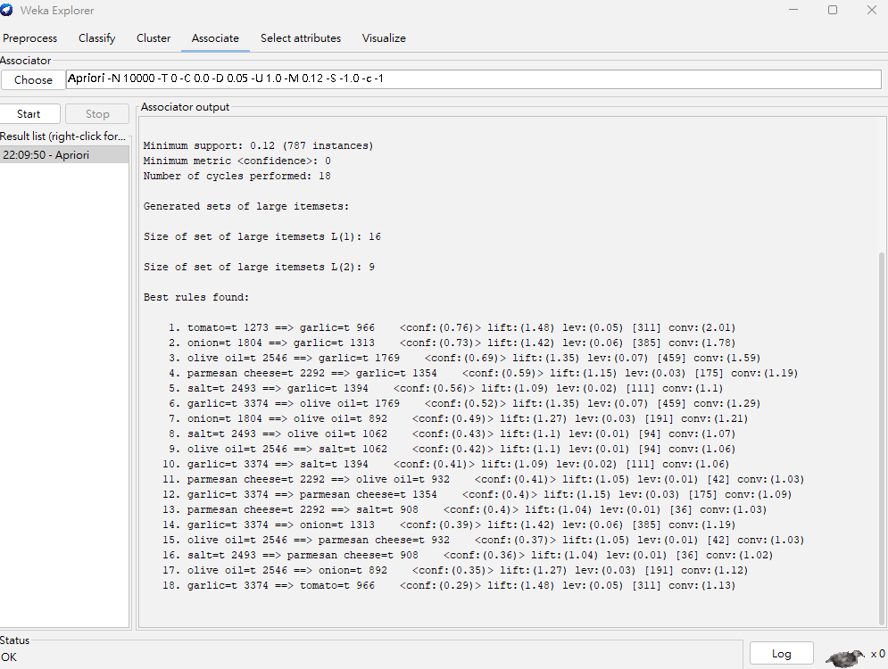
圖 2　第 2 題 Apriori 的 Weka 輸出（18 條規則）

從規則推出的項目集（支持數取自規則裡「前件 支持數 ==> 後件 支持數」的數字）：

| k | 項目集 | 支持數 | Closed？ | Maximal？ |
|---|---|---|---|---|
| 1 | {garlic} | 3,374 | ✔ | |
| 1 | {olive oil} | 2,546 | ✔ | |
| 1 | {salt} | 2,493 | ✔ | |
| 1 | {parmesan cheese} | 2,292 | ✔ | |
| 1 | {onion} | 1,804 | ✔ | |
| 1 | {tomato} | 1,273 | ✔ | |
| 2 | {olive oil, garlic} | 1,769 | ✔ | ✔ |
| 2 | {salt, garlic} | 1,394 | ✔ | ✔ |
| 2 | {parmesan cheese, garlic} | 1,354 | ✔ | ✔ |
| 2 | {onion, garlic} | 1,313 | ✔ | ✔ |
| 2 | {salt, olive oil} | 1,062 | ✔ | ✔ |
| 2 | {tomato, garlic} | 966 | ✔ | ✔ |
| 2 | {parmesan cheese, olive oil} | 932 | ✔ | ✔ |
| 2 | {parmesan cheese, salt} | 908 | ✔ | ✔ |
| 2 | {onion, olive oil} | 892 | ✔ | ✔ |

**效果解釋**

- **Frequent（15 個）**：規則裡出現 6 個食材，組成 9 個 2-itemset，合計 6 + 9 = 15 個
  Weka 的 L(1) 是 16，但另外 10 個頻繁的單一食材沒有和任何食材組成頻繁的 2-itemset，所以沒出現在規則裡
  照題目「只需考慮規則內列出的 items」，這 10 個不算
- **Maximal（9 個）**：
  - 定義：Maximal 的所有超集都不是頻繁項目集
  - 規則裡沒有任何 3-itemset，所以 9 個 2-itemset 都沒有頻繁的超集，全都是 Maximal
  - 6 個 1-itemset 各自至少包含在一個頻繁的 2-itemset 裡（例如 {tomato} ⊂ {tomato, garlic}），所以都不是 Maximal
- **Closed（15 個）**：定義是所有超集的支持數都比自己小
  - **9 個 2-itemset**：超集是 3-itemset，都不頻繁，支持數小於 787，而這些 2-itemset 的支持數都 ≥ 892
    所以超集的支持數一定比較小，9 個都是 Closed
  - **6 個 1-itemset**：每一個的支持數都比它所有超集大
    例如 {tomato} 是 1,273，唯一頻繁的超集 {tomato, garlic} 是 966，其他不頻繁的超集都小於 787；{garlic} 是 3,374，頻繁超集裡最大的 {olive oil, garlic} 是 1,769
    所以 6 個都是 Closed
- 數量關係 Maximal（9）≤ Closed（15）≤ Frequent（15），符合「Maximal ⊆ Closed ⊆ Frequent」
  這次 Closed 和 Frequent 一樣多，因為沒有任何項目集的超集和它的支持數相同

---

## Discover Interesting Patterns Across Cuisine

### Question 3　義式與泰式料理比較（min_sup = 0.12）

**回答**

- **共同點**：garlic 是兩國的中心食材，兩國都有 onion ⇒ garlic 和 salt ⇒ garlic，「蒜、洋蔥、鹽」是共同的基底
- **差異**：
  - 用油不同：義式用 olive oil，泰式用 vegetable oil
  - 調味不同：義式是「番茄、起司、橄欖油」；泰式是魚露、萊姆汁、糖一起用，講究鹹、酸、甜的平衡
  - 搭配結構不同：義式是少數核心食材互相搭配，泰式是各種調味料和香料都指向 garlic
  - 泰式的規則裡出現肉類（chicken breast），義式沒有

**操作**

1. 義式用第 1 題的 `arff/italian.arff`（6,560 筆交易、2,398 個屬性）
   泰式用同一支 `scripts/make_recipe_arff.py`，用同樣的方式把 `Thai` 表轉成 `arff/thai.arff`：952 筆交易、879 個屬性，平均每道食譜 11.30 種食材
2. 兩國都用 Weka Apriori，參數完全相同，其他用預設值：

| 參數 | 值 | 說明 |
|---|---|---|
| lowerBoundMinSupport | **0.12** | 題目指定（義式 787 筆，泰式 114 筆） |
| minMetric | **0.4** | 自訂的最小信賴度，理由見下 |
| numRules | **10000** | 預設只列 10 條，而且找到 10 條就停；要列出所有符合條件的規則，必須把上限設大 |

實際執行的指令：`weka.associations.Apriori -N 10000 -T 0 -C 0.4 -D 0.05 -U 1.0 -M 0.12 -S -1.0 -c -1`

**為什麼 confidence 設 0.4**：0.4 表示「前件出現時，後件至少有 4 成機率出現」，算中等強度的搭配
這題要比較兩國食材搭配的同質性和差異，讓兩邊的規則數量適中、彼此接近，比較好對照
結果兩國都剛好得到 12 條規則

**結果**

- 義式：Weka Log 記錄 22:57:27 開始、23:01:22 結束，輸出 `Minimum support: 0.12 (787 instances)`，共 12 條規則
- 泰式：Weka Log 記錄 23:06:57 開始、23:07:02 結束，輸出 `Minimum support: 0.12 (114 instances)`，共 12 條規則

義式（L(1) = 16、L(2) = 9，見圖 3-1）：

| # | 規則 | 支持數 | 支持度 | 信賴度 | Lift |
|---|---|---|---|---|---|
| 1 | tomato ⇒ garlic | 966 | 0.147 | 0.76 | 1.48 |
| 2 | onion ⇒ garlic | 1,313 | 0.200 | 0.73 | 1.42 |
| 3 | olive oil ⇒ garlic | 1,769 | 0.270 | 0.69 | 1.35 |
| 4 | parmesan cheese ⇒ garlic | 1,354 | 0.206 | 0.59 | 1.15 |
| 5 | salt ⇒ garlic | 1,394 | 0.212 | 0.56 | 1.09 |
| 6 | garlic ⇒ olive oil | 1,769 | 0.270 | 0.52 | 1.35 |
| 7 | onion ⇒ olive oil | 892 | 0.136 | 0.49 | 1.27 |
| 8 | salt ⇒ olive oil | 1,062 | 0.162 | 0.43 | 1.10 |
| 9 | olive oil ⇒ salt | 1,062 | 0.162 | 0.42 | 1.10 |
| 10 | garlic ⇒ salt | 1,394 | 0.212 | 0.41 | 1.09 |
| 11 | parmesan cheese ⇒ olive oil | 932 | 0.142 | 0.41 | 1.05 |
| 12 | garlic ⇒ parmesan cheese | 1,354 | 0.206 | 0.40 | 1.15 |

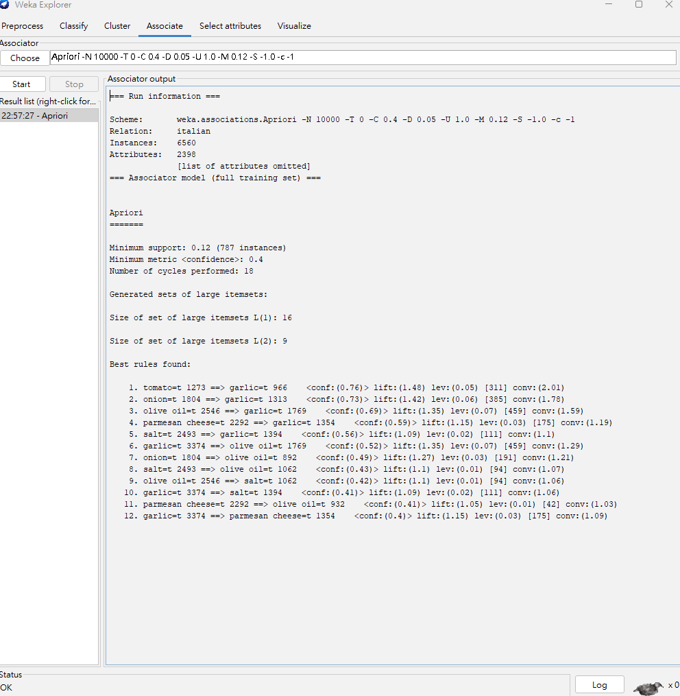
圖 3-1　義式料理的 Weka 輸出（12 條規則）

泰式（L(1) = 17、L(2) = 13，見圖 3-2）：

| # | 規則 | 支持數 | 支持度 | 信賴度 | Lift |
|---|---|---|---|---|---|
| 1 | ginger ⇒ garlic | 185 | 0.194 | 0.76 | 1.32 |
| 2 | vegetable oil ⇒ garlic | 121 | 0.127 | 0.74 | 1.30 |
| 3 | onion ⇒ garlic | 130 | 0.137 | 0.70 | 1.23 |
| 4 | soy sauce ⇒ garlic | 167 | 0.175 | 0.70 | 1.22 |
| 5 | chicken breast ⇒ garlic | 117 | 0.123 | 0.63 | 1.10 |
| 6 | fish sauce ⇒ garlic | 207 | 0.217 | 0.63 | 1.09 |
| 7 | sugar ⇒ garlic | 174 | 0.183 | 0.62 | 1.09 |
| 8 | coriander ⇒ garlic | 212 | 0.223 | 0.62 | 1.09 |
| 9 | salt ⇒ garlic | 137 | 0.144 | 0.61 | 1.07 |
| 10 | lime juice ⇒ garlic | 145 | 0.152 | 0.58 | 1.02 |
| 11 | lime juice ⇒ fish sauce | 122 | 0.128 | 0.49 | 1.41 |
| 12 | sugar ⇒ fish sauce | 122 | 0.128 | 0.44 | 1.26 |

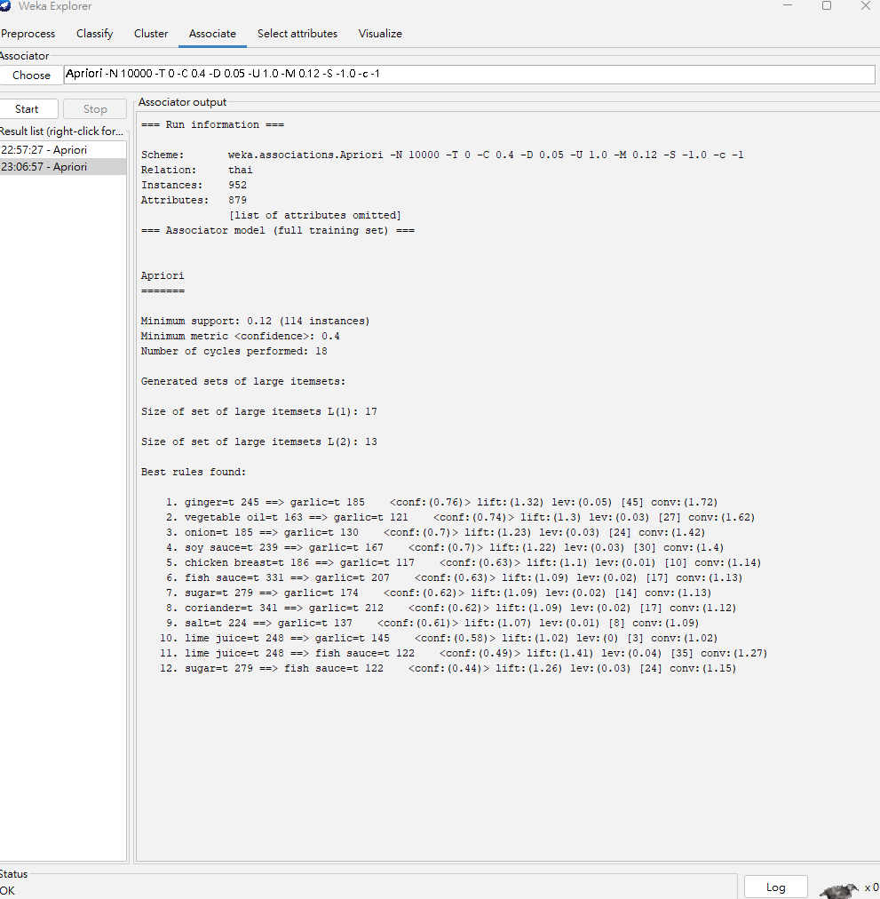
圖 3-2　泰式料理的 Weka 輸出（12 條規則）

**效果解釋**

兩國規則的對照：

| | 義式 | 泰式 |
|---|---|---|
| 後件 | garlic 5 條、olive oil 4 條、salt 2 條、parmesan cheese 1 條 | **garlic 10 條**、fish sauce 2 條 |
| 前件出現的食材 | tomato、onion、olive oil、parmesan cheese、salt、garlic | ginger、vegetable oil、onion、soy sauce、chicken breast、fish sauce、sugar、coriander、salt、lime juice |
| 雙向規則（A ⇒ B 和 B ⇒ A 都有） | 4 組：garlic ↔ olive oil、garlic ↔ salt、olive oil ↔ salt、garlic ↔ parmesan cheese | 無 |
| 兩國都有的規則 | onion ⇒ garlic（0.73）、salt ⇒ garlic（0.56） | onion ⇒ garlic（0.70）、salt ⇒ garlic（0.61） |

從規則看到的料理文化差異：

1. **共同點：garlic 是兩國的中心食材**
   兩國大部分規則的後件都是 garlic，而且都有 onion ⇒ garlic 和 salt ⇒ garlic
   可見「蒜、洋蔥、鹽」是兩種料理共同的基底
2. **用油不同**：義式用 **olive oil**，而且 olive oil 和 garlic、salt 是雙向搭配；泰式出現的是 **vegetable oil**
3. **調味體系不同**：
   - 義式的搭配集中在 tomato、parmesan cheese、olive oil，形成「番茄、起司、橄欖油」的組合
   - 泰式出現 fish sauce、soy sauce、lime juice、sugar、ginger、coriander 等調味料和香料
     其中 lime juice ⇒ fish sauce（lift 1.41）和 sugar ⇒ fish sauce（lift 1.26）顯示魚露、萊姆汁、糖常常一起用，對應泰式料理講究「鹹、酸、甜」平衡的調味方式
4. **搭配的結構不同**：
   義式有 4 組雙向規則，代表少數幾種核心食材（garlic、olive oil、salt、parmesan cheese）互相搭配，形成固定的基底
   泰式的規則幾乎都是「各種食材 ⇒ garlic」，garlic 是各種調味料和香料共同的搭配對象，調味料的種類比較多元
5. **泰式規則裡出現肉類**：泰式有 chicken breast ⇒ garlic，義式的規則裡沒有肉類，全部是調味料和基本食材

---

## Quantitative Association Rules

### Question 4　Foodmart 顧客基本資料

**回答**

3 個數量型屬性（total_children、num_children_at_home、num_cars_owned）用 NumericToNominal 轉成 nominal，每個整數值當一類
support 0.05、confidence 0.8 共得到 57 條規則，選出的 5 條有趣規則：

1. 沒有車 ⇒ 年收入 1～3 萬（lift 4.63）：沒車的人全部是最低收入族群
2. 年收入 1～3 萬、體力勞動 ⇒ 高中未畢業（lift 3.21）：低收入、勞力工作和低學歷高度重疊
3. 年收入 5～7 萬、專業人士 ⇒ 學士（lift 3.73）：和第 2 條形成高低對比
4. 高中畢業、體力勞動 ⇒ 年收入 3～5 萬（lift 2.79）：反過來從學歷和職業推出收入
5. 家中有 3 個小孩 ⇒ 有房（lift 1.37）：有關聯，但比前四條弱很多

**操作**

1. 用 `scripts/make_customer_arff.py` 從 `customer` 表取出題目指定的 9 個屬性，每位顧客一筆，產生 `arff/customer.arff`：10,281 筆、9 個屬性，沒有缺值
   - 文字欄位寫成 nominal 屬性：state_province（13 種）、yearly_income（8 個收入區間）、gender、education（5 種）、occupation（5 種）、houseowner
   - 數量型欄位保留成 numeric：total_children（0～5）、num_children_at_home（0～5）、num_cars_owned（0～4）
2. Weka 的 Apriori 只能處理 nominal 屬性，所以在 Preprocess 用 `weka.filters.unsupervised.attribute.NumericToNominal`（attributeIndices = first-last）把 3 個數量型屬性轉成 nominal，每個數值當一個類別（例如 `num_cars_owned=2`）
   這些屬性只有 5～6 種值，而且都是整數，直接分類比切成小數區間好解讀
3. Associate → `weka.associations.Apriori`，參數如下，其他用預設值：

| 參數 | 值 | 說明 |
|---|---|---|
| lowerBoundMinSupport | **0.05** | 自訂（約 514 位顧客） |
| minMetric | **0.8** | 自訂的最小信賴度 |
| numRules | **10000** | 預設只列 10 條；要先列出所有規則再挑，必須把上限設大 |

實際執行的指令：`weka.associations.Apriori -N 10000 -T 0 -C 0.8 -D 0.05 -U 1.0 -M 0.05 -S -1.0 -c -1`

**support 和 confidence 怎麼決定**：要先列出所有規則再挑有趣的，所以希望規則夠多元，但又不能被沒意義的規則淹沒，試了下面幾組：

| support | confidence | 規則數 | 觀察 |
|---|---|---|---|
| 0.1 | 0.8 | 10 | 規則太少，state_province 沒出現，而且大多是同一種關係（低收入 ⇒ 高中未畢業） |
| **0.05** | **0.8** | **57** | **9 個屬性都有出現，所有規則的 lift 都 ≥ 1.27** |
| 0.1 | 0.6 | 74 | 有 39 條 lift ≤ 1.1，多半是「⇒ 家中沒有小孩」或「⇒ 有房」這類後件本來就很常見的規則 |
| 0.05 | 0.6 | 324 | 規則很多，大部分 lift 接近 1 |

最後用 support 0.05、confidence 0.8，兼顧規則的多元性和品質

**結果**

- 輸出 `Minimum support: 0.05 (514 instances)`，共 19 個 cycles
- 頻繁項目集：L(1) 36、L(2) 240、L(3) 304、L(4) 48
- 共 57 條規則，少於上限 10000，代表全部規則都列出來了（摘要見圖 4-1，選用的規則見圖 4-2、4-3）

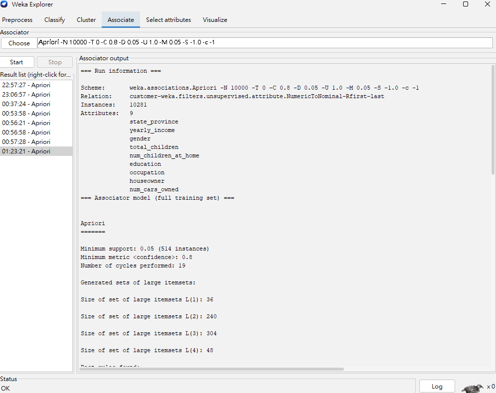
圖 4-1　第 4 題 Apriori 的 Weka 輸出摘要

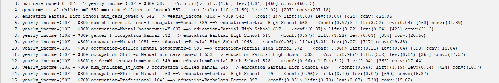
圖 4-2　Weka 輸出的第 3～15 條規則（選用 #3、#9、#15）

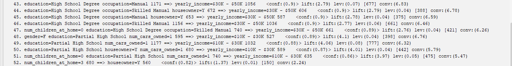
圖 4-3　Weka 輸出的第 43～52 條規則（選用 #43、#52）

Weka 輸出（節錄選用的規則）：

```
    3. num_cars_owned=0 587 ==> yearly_income=$10K - $30K 587    <conf:(1)> lift:(4.63) lev:(0.04) [460] conv:(460.13)
    9. yearly_income=$10K - $30K occupation=Manual 1081 ==> education=Partial High School 1043    <conf:(0.96)> lift:(3.21) lev:(0.07) [717] conv:(19.38)
   15. yearly_income=$50K - $70K occupation=Professional 1048 ==> education=Bachelors Degree 997    <conf:(0.95)> lift:(3.73) lev:(0.07) [730] conv:(15.02)
   43. education=High School Degree occupation=Manual 1171 ==> yearly_income=$30K - $50K 1056    <conf:(0.9)> lift:(2.79) lev:(0.07) [677] conv:(6.83)
   52. num_children_at_home=3 680 ==> houseowner=Y 560    <conf:(0.82)> lift:(1.37) lev:(0.01) [150] conv:(2.24)
 ...（共 57 條）
```

從 57 條規則中選出的五條有趣規則（支持度 = 支持數 ÷ 10,281）：

| # | Weka 編號 | 規則 | 支持數 | 支持度 | 信賴度 | Lift |
|---|---|---|---|---|---|---|
| 1 | 3 | num_cars_owned=0 ⇒ yearly_income=$10K–$30K | 587 | 0.057 | 1.00 | 4.63 |
| 2 | 9 | yearly_income=$10K–$30K, occupation=Manual ⇒ education=Partial High School | 1,043 | 0.101 | 0.96 | 3.21 |
| 3 | 15 | yearly_income=$50K–$70K, occupation=Professional ⇒ education=Bachelors Degree | 997 | 0.097 | 0.95 | 3.73 |
| 4 | 43 | education=High School Degree, occupation=Manual ⇒ yearly_income=$30K–$50K | 1,056 | 0.103 | 0.90 | 2.79 |
| 5 | 52 | num_children_at_home=3 ⇒ houseowner=Y | 560 | 0.054 | 0.82 | 1.37 |

**效果解釋**

**挑選方式**：先排除理所當然的規則，例如「total_children=0 ⇒ num_children_at_home=0」：小孩總數是 0，家中小孩數當然是 0
接著把 57 條規則照關聯的因子分群：

- **社經地位因子：收入 ↔ 學歷 ↔ 職業 ↔ 車數**
  57 條裡有 50 條屬於這一群，lift 都在 2.7 以上，是最強的關聯
- **家庭因子：有房 ↔ 小孩**：lift 約 1.3，有關聯但比較弱
- **性別、州別**：只以附加條件出現，例如「年收入 1～3 萬、男性 ⇒ 高中未畢業」，加上這個條件後信賴度幾乎不變
  代表在這份資料裡，性別和居住的州跟其他因子沒有明顯關係

照這個架構，從社經地位因子挑 4 條、家庭因子挑 1 條：

1. **沒有車 ⇒ 年收入 1～3 萬**（信賴度 1，lift 4.63）：587 位沒有車的顧客**全部**是最低收入族群
   最低收入族群只占全部顧客的 21.6%（2,222 人），沒車的人卻 100% 落在這個區間，所以 lift 高達 4.63，是 57 條規則裡最高的
   也就是說，「有沒有車」是判斷低收入非常直接的指標
2. **年收入 1～3 萬、體力勞動工作 ⇒ 高中未畢業**（信賴度 0.96，lift 3.21）：全部顧客裡高中未畢業的只有約 30%，但低收入的體力勞動者有 96% 沒讀完高中
   這條代表 57 條裡數量最多的「低收入 ⇒ 高中未畢業」那一群規則，反映低收入、勞力工作和低學歷三者高度重疊
3. **年收入 5～7 萬、專業人士 ⇒ 學士學歷**（信賴度 0.95，lift 3.73）：學士只占全部顧客約 25%，但中等收入的專業人士有 95% 是學士
   這條和第 2 條形成高低對比：知道收入和職業，幾乎就能推出學歷在哪一端
4. **高中畢業、體力勞動工作 ⇒ 年收入 3～5 萬**（信賴度 0.90，lift 2.79）：方向和第 2、3 條相反，是從學歷和職業推出收入
   年收入 3～5 萬的人約占 32%，高中畢業的體力勞動者則有 90% 落在這個區間
   可見收入、學歷、職業三者可以互相推論，是一組緊密連動的社經地位因子
5. **家中有 3 個小孩 ⇒ 有房**（信賴度 0.82，lift 1.37）：全部顧客裡約 60% 有房，家裡有 3 個小孩的顧客則有 82% 有房，是一般顧客的 1.37 倍
   這表示小孩數和有沒有房確實有關，但關聯不算強
   前四條的 lift 都在 2.79～4.63，收入、學歷、職業之間可以互相推得很準；知道小孩數，對判斷有沒有房的幫助就小得多
   用 SQL 查各小孩數的有房率，家中沒有小孩的只有 51.2%，有 1～5 個小孩的都在 70%～82%
   所以有房和「家中有沒有小孩」有關，不只是 3 個小孩
   Weka 只找到 3 個小孩這條，是因為 4 個小孩的人數低於 support 門檻，1、2 個小孩的信賴度低於 0.8

   | 家中小孩數 | 人數 | 有房 | 有房率 |
   |---|---|---|---|
   | 0 | 6,457 | 3,308 | 51.2% |
   | 1 | 1,495 | 1,091 | 73.0% |
   | 2 | 976 | 682 | 69.9% |
   | 3 | 680 | 560 | 82.4% |
   | 4 | 477 | 393 | 82.4% |
   | 5 | 196 | 153 | 78.1% |
   | 全部 | 10,281 | 6,187 | 60.2% |

   註：這張表是用下面的 SQL 算出來的，不是 Weka 的輸出：

   ```sql
   SELECT num_children_at_home, COUNT(*) AS n,
          SUM(houseowner = 'Y') AS own,
          ROUND(100.0 * SUM(houseowner = 'Y') / COUNT(*), 1) AS pct
   FROM customer
   GROUP BY num_children_at_home;
   ```

---

## Discover Interesting Patterns in Customer Purchases

### Question 5　12 月與 1～11 月的購物行為比較

**回答**

- **相似的地方**：
  - 各類別的購買比例幾乎一樣，最常買的都是 Vegetables（約 44%）和 Snack Foods（約 42%）
  - 規則的結構相同，後件幾乎都是 Vegetables 和 Snack Foods，很多規則兩段期間都有、信賴度也接近
  - 類別之間的關聯都很弱，lift 都接近 1
- **差異的地方**：
  - 12 月的購物次數明顯變多：3,771 籃，比 1～11 月的月平均多約 22%
  - 購買比例上升最多的只有 Candles、Beer and Wine，而且只有約 1.1 倍
  - 12 月的規則稍微多一點、稍微強一點，還多出以 Dairy 為後件的規則；也有規則變弱，例如 Eggs ⇒ Vegetables
  - 總結：12 月的差別主要是「買的次數變多」，買的東西和搭配大致不變

**操作**

1. **交易的定義**：銷售資料沒有收據編號，所以把**同一位顧客在同一天**（`customer_id` + `time_id`）買的商品當成一次購物，也就是一筆交易
2. **商品的層級**：每筆交易平均不到 5 件商品，直接拿 1,559 種商品當 item 的話組合太分散，很難找到規則
   所以用 `product_class` 的 **product_category**（47 種）當 item，分類夠細，看得出是哪一類商品
3. 用 `scripts/make_sales_arff.py` 把 `sales_fact_1998`（1～11 月）和 `sales_fact_dec_1998`（12 月）分別 join `product` 和 `product_class`，產生兩份交易式 ARFF
   兩份用同一組 47 個 category 屬性，有買記 `t`，沒買記 `?`：

| 檔案 | 交易數 | 每筆交易的 category 數 |
|---|---|---|
| `arff/sales_1998_jan_nov.arff` | 34,015 | 平均 4.30（1～18） |
| `arff/sales_1998_dec.arff` | 3,771 | 平均 4.31（1～17） |

4. **每月購物籃數**：用下面的 SQL 算出每個月有幾籃，用來比較 12 月和平常月份的購物量：

```sql
SELECT t.month_of_year, t.the_month,
       COUNT(DISTINCT s.customer_id || '-' || s.time_id) AS baskets,
       COUNT(DISTINCT t.time_id) AS days
FROM sales_fact_1998 s                       -- 12 月改成 sales_fact_dec_1998
JOIN time_by_day t ON s.time_id = t.time_id
GROUP BY t.month_of_year
ORDER BY t.month_of_year;
```

5. **各類別的購買比例和銷售件數**：用下面的 SQL 算出每個 category 出現在幾籃、賣出幾件
   購買比例 = 該類別的籃數 ÷ 總籃數（1～11 月 34,015 籃，12 月 3,771 籃）：

```sql
SELECT pc.product_category,
       COUNT(DISTINCT s.customer_id || '-' || s.time_id) AS baskets,
       SUM(s.unit_sales) AS units
FROM sales_fact_1998 s                       -- 12 月改成 sales_fact_dec_1998
JOIN product p ON s.product_id = p.product_id
JOIN product_class pc ON p.product_class_id = pc.product_class_id
GROUP BY pc.product_category;
```

6. 兩份資料都用 Weka Apriori，**參數相同**，比較才公平：

| 參數 | 值 | 說明 |
|---|---|---|
| lowerBoundMinSupport | **0.03** | 自訂（1～11 月 1,020 筆，12 月 113 筆） |
| minMetric | **0.3** | 自訂的最小信賴度 |
| numRules | **10000** | 預設只列 10 條，要列出全部規則必須把上限設大 |

實際執行的指令：`weka.associations.Apriori -N 10000 -T 0 -C 0.3 -D 0.05 -U 1.0 -M 0.03 -S -1.0 -c -1`

**support 和 confidence 怎麼決定**：先用 1～11 月的資料試了三組：

| support | confidence | 規則數 |
|---|---|---|
| 0.05 | 0.5 | 0 |
| 0.03 | 0.5 | 0 |
| **0.03** | **0.3** | **53** |

信賴度設 0.5 時，就算支持度降到 0.03 也沒有任何規則
代表商品類別之間沒有「買了 A 就有一半以上機率買 B」的強烈搭配
所以用唯一跑得出規則的 0.03／0.3

**結果**

- 1～11 月：`Minimum support: 0.03 (1020 instances)`，L(1) 36、L(2) 62、L(3) 5，共 53 條規則（見圖 5-1）
- 12 月：`Minimum support: 0.03 (113 instances)`，L(1) 36、L(2) 69、L(3) 9，共 65 條規則（見圖 5-2）

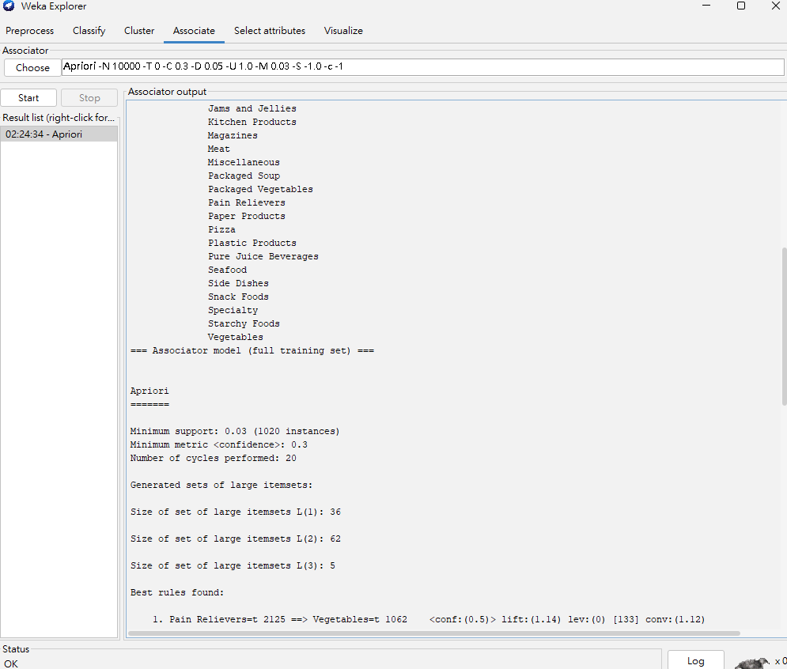
圖 5-1　1～11 月 Apriori 的 Weka 輸出

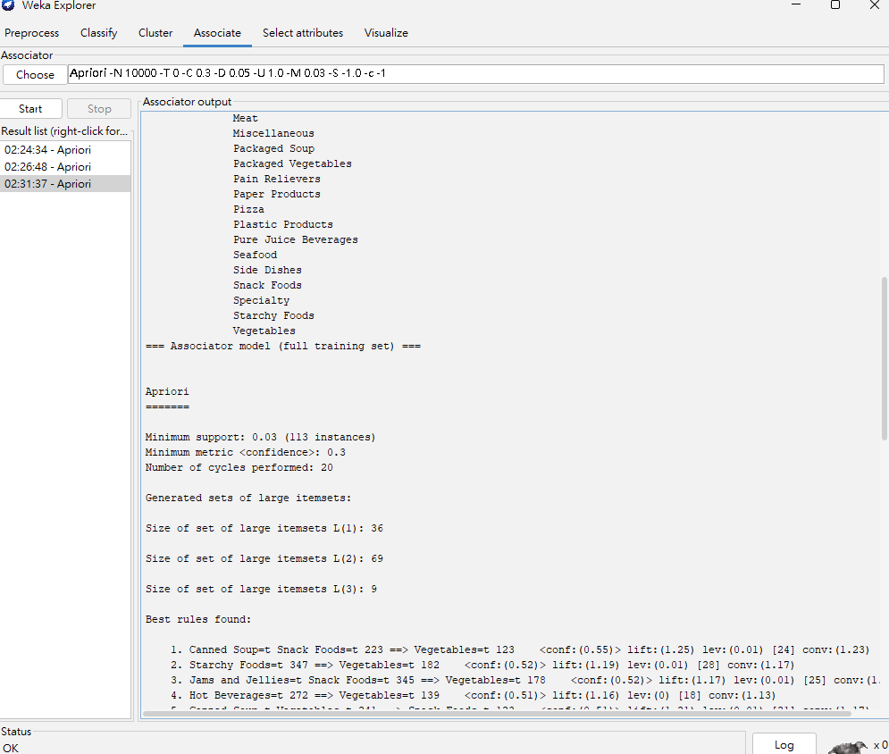
圖 5-2　12 月 Apriori 的 Weka 輸出

1～11 月的 Weka 輸出（節錄，省略 47 個屬性名稱）：

```
=== Run information ===
Scheme:       weka.associations.Apriori -N 10000 -T 0 -C 0.3 -D 0.05 -U 1.0 -M 0.03 -S -1.0 -c -1
Relation:     sales_1998_jan_nov
Instances:    34015
Attributes:   47

Minimum support: 0.03 (1020 instances)
Minimum metric <confidence>: 0.3
Number of cycles performed: 20

Size of set of large itemsets L(1): 36
Size of set of large itemsets L(2): 62
Size of set of large itemsets L(3): 5

Best rules found:
 1. Pain Relievers=t 2125 ==> Vegetables=t 1062    <conf:(0.5)> lift:(1.14)
 2. Specialty=t 3013 ==> Vegetables=t 1499    <conf:(0.5)> lift:(1.14)
 3. Kitchen Products=t 2534 ==> Vegetables=t 1247    <conf:(0.49)> lift:(1.13)
 4. Magazines=t 2537 ==> Vegetables=t 1227    <conf:(0.48)> lift:(1.11)
 5. Jams and Jellies=t Snack Foods=t 2971 ==> Vegetables=t 1434    <conf:(0.48)> lift:(1.11)
 ...（共 53 條）
```

12 月的 Weka 輸出（節錄）：

```
=== Run information ===
Scheme:       weka.associations.Apriori -N 10000 -T 0 -C 0.3 -D 0.05 -U 1.0 -M 0.03 -S -1.0 -c -1
Relation:     sales_1998_dec
Instances:    3771
Attributes:   47

Minimum support: 0.03 (113 instances)
Minimum metric <confidence>: 0.3
Number of cycles performed: 20

Size of set of large itemsets L(1): 36
Size of set of large itemsets L(2): 69
Size of set of large itemsets L(3): 9

Best rules found:
 1. Canned Soup=t Snack Foods=t 223 ==> Vegetables=t 123    <conf:(0.55)> lift:(1.25)
 2. Starchy Foods=t 347 ==> Vegetables=t 182    <conf:(0.52)> lift:(1.19)
 3. Jams and Jellies=t Snack Foods=t 345 ==> Vegetables=t 178    <conf:(0.52)> lift:(1.17)
 4. Hot Beverages=t 272 ==> Vegetables=t 139    <conf:(0.51)> lift:(1.16)
 5. Canned Soup=t Vegetables=t 241 ==> Snack Foods=t 123    <conf:(0.51)> lift:(1.21)
 ...（共 65 條）
```

每月購物籃數（SQL）：

| 月 | 籃數 | 有銷售的天數 | 每天平均籃數 |
|---|---|---|---|
| 1 | 3,092 | 29 | 106.6 |
| 2 | 3,007 | 28 | 107.4 |
| 3 | 3,128 | 28 | 111.7 |
| 4 | 2,960 | 29 | 102.1 |
| 5 | 2,983 | 29 | 102.9 |
| 6 | 3,002 | 29 | 103.5 |
| 7 | 3,112 | 30 | 103.7 |
| 8 | 3,016 | 30 | 100.5 |
| 9 | 3,147 | 30 | 104.9 |
| 10 | 2,915 | 28 | 104.1 |
| 11 | **3,653** | 30 | **121.8** |
| 12 | **3,771** | 30 | **125.7** |

1～11 月平均每月 3,092 籃（最少 2,915、最多 3,653）

各類別在 12 月的變化（SQL）
倍數 = 12 月購買比例 ÷ 1～11 月購買比例；件數的比較基準是 1～11 月的每月平均：

| 類別 | 1～11 月購買比例 | 12 月購買比例 | 倍數 | 1～11 月每月平均件數 | 12 月件數 |
|---|---|---|---|---|---|
| Candles | 1.5% | 1.7% | 1.11 | 144 | 193 |
| Beer and Wine | 11.6% | 12.7% | 1.09 | 1,188 | 1,601 |
| Seafood | 2.9% | 3.1% | 1.08 | 281 | 374 |
| Canned Tuna | 3.1% | 3.3% | 1.06 | 296 | 396 |
| Jams and Jellies | 19.1% | 20.3% | 1.06 | 2,051 | 2,749 |
| … | | | | | |
| Hygiene | 5.9% | 5.3% | 0.89 | 589 | 628 |
| Packaged Vegetables | 1.5% | 1.3% | 0.88 | 147 | 153 |
| Canned Shrimp | 1.5% | 1.3% | 0.84 | 148 | 150 |

表中列出比例上升最多的 5 類和下降最多的 3 類，其他類別的倍數大約在 0.90～1.05 之間

規則整體比較：

| | 1～11 月 | 12 月 |
|---|---|---|
| L(1)、L(2)、L(3) | 36、62、5 | 36、69、9 |
| 規則數 | 53 | 65 |
| 後件出現的類別 | Vegetables、Snack Foods | Vegetables、Snack Foods、Dairy（5 條） |
| 信賴度範圍 | 0.42～0.50 | 0.30～0.55 |
| Lift 範圍 | 0.99～1.15 | 0.93～1.25 |

從 Weka 規則算出的購買比例（前件的支持數 ÷ 交易數）：Vegetables 1～11 月 43.7%、12 月 44.2%，Snack Foods 兩段期間都是 42.1%

代表性規則的比較（「—」表示該期間沒有出現這條規則）：

| 規則 | 1～11 月 信賴度／Lift | 12 月 信賴度／Lift |
|---|---|---|
| Pain Relievers ⇒ Vegetables | 0.50／1.14 | 0.51／1.15 |
| Magazines ⇒ Snack Foods | 0.48／1.13 | 0.49／1.16 |
| Jams and Jellies, Snack Foods ⇒ Vegetables | 0.48／1.11 | 0.52／1.17 |
| Canned Soup ⇒ Vegetables | 0.47／1.07 | 0.49／1.12 |
| Meat ⇒ Vegetables | 0.46／1.06 | 0.47／1.07 |
| Snack Foods ⇒ Vegetables | 0.45／1.04 | 0.47／1.05 |
| Starchy Foods ⇒ Vegetables | 0.45／1.03 | 0.52／1.19 |
| Hot Beverages ⇒ Vegetables | 0.46／1.06 | 0.51／1.16 |
| Eggs ⇒ Vegetables | 0.48／1.10 | 0.41／0.93 |
| Beer and Wine ⇒ Vegetables | 0.45／1.04 | 0.42／0.95 |
| Canned Soup, Snack Foods ⇒ Vegetables | — | 0.55／1.25 |
| Pure Juice Beverages ⇒ Vegetables | — | 0.51／1.15 |
| Fruit ⇒ Dairy | — | 0.30／1.15 |
| Candy ⇒ Dairy | — | 0.30／1.15 |

**效果解釋**

**相似之處：買的東西幾乎一樣**

1. **各類別的購買比例相同**：所有類別在兩段期間的比例差距都在 1.5 個百分點以內，最常買的都是 Vegetables（約 44%）和 Snack Foods（約 42%）
   每籃平均買的類別數也一樣（4.30 和 4.31）
2. **規則的結構相同**：兩段期間的規則後件幾乎都是 Vegetables 和 Snack Foods，很多規則兩段期間都有，而且信賴度很接近（例如 Pain Relievers ⇒ Vegetables 是 0.50 和 0.51）
3. **類別之間的關聯都很弱**：兩段期間的 lift 都接近 1，信賴度最高也只有約 0.5
   這些規則主要反映 Vegetables 和 Snack Foods 本來就很常被買，商品類別之間並沒有強烈的搭配購買關係

**差異之處：12 月買得比較多，組合只有一點點變化**

1. **購物量明顯增加**：12 月有 3,771 籃，是全年最多的月份，比 1～11 月的月平均（3,092 籃）多約 22%
   每天平均 125.7 籃，平常大約是 100～112 籃，符合題目說的「12 月是購物旺季」
   11 月也明顯偏高（3,653 籃，每天 121.8 籃），可能和美國 11 月底的感恩節購物季有關
2. **相對變熱門的類別很少**：
   - 因為來買的人變多，12 月大部分類別的銷售件數都比 1～11 月的每月平均高
     例如 Beer and Wine 從 1,188 件增加到 1,601 件（+35%），Candles 從 144 件增加到 193 件（+34%）
   - 但看購買比例的話，category 層級的變化都很小
     上升最多的是 Candles（1.11 倍）和 Beer and Wine（1.09 倍），和節慶的直覺一致，不過幅度只有約 1 成
   - 所以 12 月銷售量增加，主要是購物次數變多，而不是某些類別特別熱賣
3. **12 月的搭配稍微多一點**：12 月的 L(2)、L(3) 和規則數都比較多，最高的信賴度和 lift 也略高
   例如「Canned Soup, Snack Foods ⇒ Vegetables」（0.55／1.25）是兩段期間裡最強的規則
4. **12 月多出以 Dairy 為後件的規則**：例如 Fruit ⇒ Dairy、Candy ⇒ Dairy（lift 1.15），只出現在 12 月
   不過它們的信賴度只有 0.30，剛好在門檻上
5. **部分規則在 12 月變弱**：例如 Eggs ⇒ Vegetables 從 1～11 月的 0.48（lift 1.10）降到 12 月的 0.41（lift 0.93）
   lift 小於 1，表示 12 月買蛋的人反而比較少同時買蔬菜

**總結**：12 月和平常月份最主要的差異是**購物次數變多**
買的商品類別和它們之間的搭配大致不變；在類別層級上，節慶相關的只有 Candles、Beer and Wine 的比例略為上升（約 1.1 倍），Candy、Baking Goods 的比例則和平常差不多
上面 3～5 點的規則差異幅度都很小，而且 12 月只有 3,771 筆交易（1～11 月有 34,015 筆），樣本少、數字比較容易波動，只能當作輔助觀察

---

## Open-Ended Association Rule Mining

### Question 6　自訂分析

本題分成三個部分：6-1 用顧客資料看學歷與職業的關聯，6-2 用銷售資料看促銷活動與銷售量的關聯，6-3 用食譜資料看同一地區的食材相似度
三個部分共選出 23 條規則

#### 6-1　學歷與職業

**回答**

support 0.015、confidence 0.7 共得到 1,479 條規則，選出 4 條：

- 文書職員全部是大學肄業（lift 10.38），而且 8 成同時是年收入 3～5 萬（lift 11.70），是特徵最鮮明的族群
- 高收入（13～15 萬）和研究所學歷的顧客，都有 7 成是專業人士（lift 約 2.2），但不像文書職員那麼集中

**操作**

1. **動機**：Clerical（文書職員）只占顧客約 2%，support 設太高的話這類小族群的規則就找不到
   所以把 support 降到 0.015（154 人），看學歷和職業之間更細的關聯
2. 用 `scripts/make_customer_arff.py` 產生的 `arff/customer.arff`（10,281 筆、9 個屬性），在 Preprocess 用 `NumericToNominal`（attributeIndices = first-last）把 3 個數量型屬性轉成 nominal
3. Associate → `weka.associations.Apriori`，參數如下，其他用預設值：

| 參數 | 值 | 說明 |
|---|---|---|
| lowerBoundMinSupport | **0.015** | 自訂（154 人），讓占 2% 左右的族群也能進入頻繁項目集 |
| minMetric | **0.7** | 自訂的最小信賴度 |
| numRules | **10000** | 要列出全部規則，必須把上限設大 |

Weka Run information（省略屬性名稱）：

```
Scheme:       weka.associations.Apriori -N 10000 -T 0 -C 0.7 -D 0.05 -U 1.0 -M 0.015 -S -1.0 -c -1
Relation:     customer-weka.filters.unsupervised.attribute.NumericToNominal-Rfirst-last
Instances:    10281
Attributes:   9
```

**support 和 confidence 怎麼決定**：support 固定在 0.015，試了下面幾組門檻：

| 衡量方式 | 門檻 | 規則數 | 觀察 |
|---|---|---|---|
| confidence | 0.95 | 219 | 以「⇒ 高中未畢業」「⇒ 家中沒有小孩」為主，高收入族群沒有任何規則 |
| confidence | 0.9 | 482 | 和 0.95 差不多，高收入族群還是沒有規則 |
| **confidence** | **0.7** | **1,479** | **高收入、研究所、文書職員相關的規則都出現了** |
| lift | 3 | 4,024 | 大量規則是前後件對調的版本，信賴度只有 0.1～0.2 |
| lift | 2 | 10,000 | 碰到 numRules 上限，沒有列完 |

confidence 0.9 以上時，高收入和研究所學歷的規則都不會出現，所以用 confidence 0.7

**結果**

- 輸出 `Minimum support: 0.01 (154 instances)`
  設定值是 0.015，Weka 顯示時四捨五入成 0.01，實際門檻是 154 人，共 20 個 cycles
- 頻繁項目集：L(1) 45、L(2) 507、L(3) 1,644、L(4) 1,450、L(5) 363、L(6) 26
- 共 1,479 條規則，少於上限 10000，代表全部規則都列出來了（見圖 6-1）

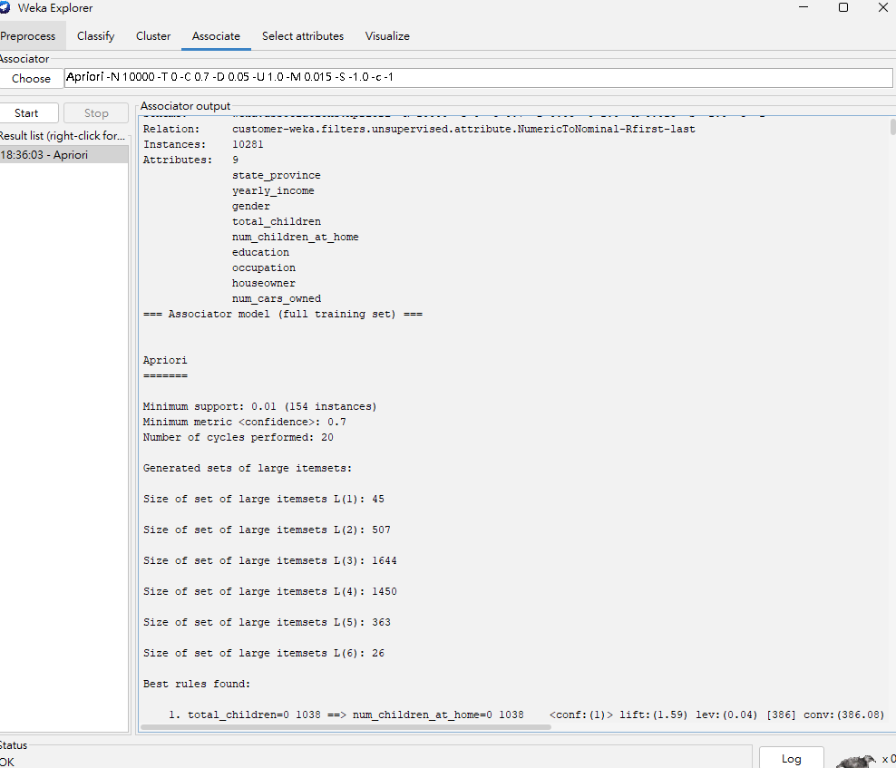
圖 6-1　6-1 Apriori 的 Weka 輸出摘要

Weka 輸出（節錄選用的規則）：

```
   45. occupation=Clerical 205 ==> education=Partial College 205    <conf:(1)> lift:(10.38) lev:(0.02) [185] conv:(185.26)
  679. occupation=Clerical 205 ==> yearly_income=$30K - $50K education=Partial College 164    <conf:(0.8)> lift:(11.7) lev:(0.01) [149] conv:(4.55)
 1248. yearly_income=$130K - $150K 506 ==> occupation=Professional 367    <conf:(0.73)> lift:(2.2) lev:(0.02) [200] conv:(2.43)
 1339. yearly_income=$110K - $130K 493 ==> occupation=Professional 352    <conf:(0.71)> lift:(2.17) lev:(0.02) [189] conv:(2.33)
 1371. education=Graduate Degree 539 ==> occupation=Professional 383    <conf:(0.71)> lift:(2.16) lev:(0.02) [205] conv:(2.3)
 ...（共 1,479 條）
```

從 1,479 條規則中選出的四條（支持度 = 支持數 ÷ 10,281）：

| # | Weka 編號 | 規則 | 支持數 | 支持度 | 信賴度 | Lift |
|---|---|---|---|---|---|---|
| 1 | 45 | occupation=Clerical ⇒ education=Partial College | 205 | 0.020 | 1.00 | 10.38 |
| 2 | 679 | occupation=Clerical ⇒ yearly_income=$30K–$50K, education=Partial College | 164 | 0.016 | 0.80 | 11.70 |
| 3 | 1248 | yearly_income=$130K–$150K ⇒ occupation=Professional | 367 | 0.036 | 0.73 | 2.20 |
| 4 | 1371 | education=Graduate Degree ⇒ occupation=Professional | 383 | 0.037 | 0.71 | 2.16 |

**效果解釋**

1. **文書職員 ⇒ 大學肄業**（信賴度 1，lift 10.38）：205 位文書職員**全部**是大學肄業
   全部顧客裡大學肄業的只有 990 人（約 9.6%），所以 lift 超過 10
2. **文書職員 ⇒ 年收入 3～5 萬且大學肄業**（信賴度 0.80，lift 11.70，是全部 1,479 條裡最高的）：全部顧客裡同時符合這兩個條件的只有約 6.8%（信賴度 ÷ lift），文書職員卻有 8 成
   這個族群的職業、學歷、收入三者幾乎固定，是特徵最鮮明的族群
3. **年收入 13～15 萬 ⇒ 專業人士**（信賴度 0.73，lift 2.20）：年收入 11～13 萬的也有同樣的規則（#1339，信賴度 0.71）
   專業人士在全部顧客裡約占 33%（信賴度 ÷ lift），高收入族群裡則超過 7 成
   不過信賴度只有 0.7 左右，設 0.9 以上時完全找不到高收入族群的規則，表示高收入族群的職業不像文書職員那麼集中
4. **研究所學歷 ⇒ 專業人士**（信賴度 0.71，lift 2.16）：研究所學歷的顧客有 7 成是專業人士，大約是整體比例的 2 倍
   方向和第 3 條一致，高學歷和高收入都指向專業人士

#### 6-2　促銷活動與銷售量

**回答**

support 0.01、confidence 0.5 共得到 364 條規則，選出 5 條：

- 促銷日比較容易是高銷量日（54%，一般約 1/3），用日報宣傳的效果最好（76%）
- 週日加上促銷，72% 是高銷量日
- 12 月是旺季（73% 高銷量），而且 12 月促銷反而比較少，是季節因素
- 10 月沒有促銷時，55% 是低銷量日

**操作**

1. **為什麼以「店-日」為交易**：用 SQL 查每家店每天出現幾種 promotion_id：

```sql
SELECT k, COUNT(*) FROM (
  SELECT store_id, time_id, COUNT(DISTINCT promotion_id) AS k
  FROM sales_fact_1998 GROUP BY store_id, time_id
) GROUP BY k;
```

   結果全部是 `k = 1`（1,320 組），也就是促銷是記在「某家店的某一天」上，不是記在個別商品上
   所以把同一家店同一天（`store_id` + `time_id`）當成一筆交易，看「這天有沒有促銷」和「這天賣得好不好」的關係
   （這段是 SQL 的結果，不是 Weka 的輸出）

2. 用 `scripts/make_q6_storeday_arff.py` 把 `sales_fact_1998` 和 `sales_fact_dec_1998` 合併（1998 全年），串 `store`、`time_by_day`、`promotion`，產生 `arff/q6_storeday.arff`：1,440 筆交易（24 家店），6 個 nominal 屬性：

| 屬性 | 值 | 來源 |
|---|---|---|
| promotion | yes／no | promotion_id 是否為 0 |
| media_type | 13 種廣告媒體，沒有促銷的日子記 `?` | promotion.media_type |
| day | 星期一～日 | time_by_day.the_day |
| month | 1～12 | time_by_day.month_of_year |
| store_type | 5 種商店類型 | store.store_type |
| sales_level | low／mid／high | 當天賣出件數（unit_sales 加總），和**同一家店**全年的店日比，依三分位切分 |

   - sales_level 和自己的店比，是為了排除大店、小店的規模差異
     切完後 low 469、mid 483、high 488，各約占 1/3
   - 沒有促銷的日子 media_type 記成 `?`，避免和 `promotion=no` 重複產生同樣的規則

3. Associate → `weka.associations.Apriori`，參數如下，其他用預設值：

| 參數 | 值 | 說明 |
|---|---|---|
| lowerBoundMinSupport | **0.01** | 自訂（14 個店日） |
| minMetric | **0.5** | 自訂的最小信賴度 |
| numRules | **10000** | 要列出全部規則，必須把上限設大 |

Weka Run information（省略屬性名稱）：

```
Scheme:       weka.associations.Apriori -N 10000 -T 0 -C 0.5 -D 0.05 -U 1.0 -M 0.01 -S -1.0 -c -1
Relation:     q6_storeday
Instances:    1440
Attributes:   6
```

**support 和 confidence 怎麼決定**：

| support | 門檻 | 規則數 | 結論是 sales_level 的規則 | 觀察 |
|---|---|---|---|---|
| 0.02（29 店日） | conf 0.5 | 133 | 16 | 每種媒體只有 17～40 個店日，大多不到 29，沒有任何媒體規則 |
| **0.01（14 店日）** | **conf 0.5** | **364** | **68** | **促銷、媒體、季節的規則都會出現** |
| 0.01 | conf 0.6 | 299 | 31 | 整體的「促銷 ⇒ 高銷量」（信賴度 0.54）被濾掉 |
| 0.01 | lift 1.5 | 434 | 65 | 和 conf 0.5 差不多 |

規則用 confidence 排序比較容易看出結論的可靠程度，所以用 support 0.01、confidence 0.5

**結果**

- 輸出 `Minimum support: 0.01 (14 instances)`，共 20 個 cycles
- 頻繁項目集：L(1) 42、L(2) 297、L(3) 311、L(4) 46
- 共 364 條規則，少於上限 10000，代表全部規則都列出來了（見圖 6-2）
- 前 13 條是「media_type=X ⇒ promotion=yes」（信賴度 1）
  有媒體就一定有促銷，這是資料設計本來就會產生的規則，沒有分析意義

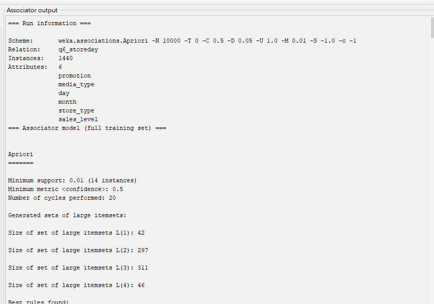
圖 6-2　6-2 Apriori 的 Weka 輸出摘要

Weka 輸出（節錄選用及解釋中引用的規則）：

```
   62. day=Monday 213 ==> promotion=no 198    <conf:(0.93)> lift:(1.21) lev:(0.02) [34] conv:(3.12)
  113. month=10 120 ==> promotion=no 102    <conf:(0.85)> lift:(1.11) lev:(0.01) [10] conv:(1.48)
  135. month=12 120 ==> promotion=no 99    <conf:(0.82)> lift:(1.08) lev:(0) [7] conv:(1.28)
  191. media_type=Daily Paper 25 ==> sales_level=high 19    <conf:(0.76)> lift:(2.24) lev:(0.01) [10] conv:(2.36)
  223. month=12 120 ==> sales_level=high 88    <conf:(0.73)> lift:(2.16) lev:(0.03) [47] conv:(2.4)
  234. promotion=yes day=Sunday 29 ==> sales_level=high 21    <conf:(0.72)> lift:(2.14) lev:(0.01) [11] conv:(2.13)
  316. day=Friday 201 ==> promotion=no 114    <conf:(0.57)> lift:(0.74) lev:(-0.03) [-39] conv:(0.54)
  329. promotion=no month=10 102 ==> sales_level=low 56    <conf:(0.55)> lift:(1.69) lev:(0.02) [22] conv:(1.46)
  333. promotion=yes 338 ==> sales_level=high 184    <conf:(0.54)> lift:(1.61) lev:(0.05) [69] conv:(1.44)
 ...（共 364 條）
```

從 364 條規則中選出的五條（支持度 = 店日數 ÷ 1,440；任何一天屬於 high 的比例約 33.9%，屬於 low 約 32.6%）：

| # | Weka 編號 | 規則 | 支持數 | 支持度 | 信賴度 | Lift |
|---|---|---|---|---|---|---|
| 1 | 333 | promotion=yes ⇒ sales_level=high | 184 | 0.128 | 0.54 | 1.61 |
| 2 | 191 | media_type=Daily Paper ⇒ sales_level=high | 19 | 0.013 | 0.76 | 2.24 |
| 3 | 234 | promotion=yes, day=Sunday ⇒ sales_level=high | 21 | 0.015 | 0.72 | 2.14 |
| 4 | 223 | month=12 ⇒ sales_level=high | 88 | 0.061 | 0.73 | 2.16 |
| 5 | 329 | promotion=no, month=10 ⇒ sales_level=low | 56 | 0.039 | 0.55 | 1.69 |

**效果解釋**

1. **促銷日比較容易是高銷量日**（#333）：一般只有約 1/3 的店日是高銷量，促銷日則有 54%，lift 1.61
   這不是因為促銷剛好排在週末：從 Weka 的其他規則看得出，促銷大多排在週四、週五
   day=Friday ⇒ promotion=no 的信賴度只有 0.57（#316），約 43% 的週五有促銷；週一則是 0.93（#62），只有約 7% 有促銷
   而且單獨的「星期幾 ⇒ high」規則一條都沒有出現
2. **不同媒體效果不同**（#191）：用 Daily Paper（日報）宣傳的 25 個店日中，有 19 個是高銷量日（信賴度 0.76），是效果最好的媒體
   其他媒體像 Sunday Paper（0.67）、Radio（0.59）、In-Store Coupon（0.52）也都高於基準的 1/3
   不過每種媒體只有 17～40 個店日，樣本偏少
   註：各媒體的店日數是用下面的 SQL 算出來的：

   ```sql
   SELECT pr.media_type, COUNT(*) AS store_days
   FROM (SELECT DISTINCT store_id, time_id, promotion_id
         FROM (SELECT * FROM sales_fact_1998 UNION ALL SELECT * FROM sales_fact_dec_1998)) s
   JOIN promotion pr ON s.promotion_id = pr.promotion_id
   WHERE s.promotion_id <> 0
   GROUP BY pr.media_type;
   -- 最少 Sunday Paper, Radio 17 個店日，最多 Daily Paper, Radio 40 個店日，13 種合計 338（= promotion=yes 的店日數）
   ```
3. **週日加上促銷效果更明顯**（#234）：週日有促銷時，72% 是高銷量日（lift 2.14），但單獨的「day=Sunday ⇒ high」規則並沒有出現
4. **12 月是旺季**（#223）：12 月有 73% 的店日是高銷量
   而且 12 月的促銷其實比較少：month=12 ⇒ promotion=no 的信賴度是 0.82（#135），只有約 18% 有促銷
   所以 12 月賣得好是季節因素，不是促銷造成的
5. **10 月沒有促銷時銷量偏低**（#329）：10 月沒有促銷的日子有 55% 是低銷量
   10 月也是全年促銷最少的月份：month=10 ⇒ promotion=no 的信賴度是 0.85（#113），只有約 15% 有促銷

#### 6-3　同一地區的食材相似度

**回答**

東亞（中、日）和歐洲（德、西）各自用 support 0.02、confidence 0.6，分別得到 2,080 條和 875 條規則，選出 14 條：

- **地區共用的食材**（5 條）：東亞是醬油、糖和「醬油加糖」，歐洲是洋蔥和杏仁，兩國的使用比例都差不多（lift 1.00～1.04）
- **地區內的特色食材與組合**（9 條）：只有少數，例如日式的味醂、清酒，中式的海鮮醬，德式的德國酸菜、葛縷子，西班牙的番紅花、西班牙香腸
- 同一地區共用支持數高的基礎調味，國家之間的差異集中在少數特色食材

**操作**

1. **動機**：驗證同一地區（東亞、歐洲）的食譜是不是用相同的食材
   把同地區兩國的食譜合成一份資料，加上 `cuisine` 屬性標示國家，再看「食材 ⇒ cuisine」規則的 lift
   lift 接近 1，代表這種食材在兩國的使用比例差不多，是這個地區**共用的食材**
   lift 接近上限（1 ÷ 該國比例），代表這種食材幾乎只出現在其中一國，是地區內**少數能分辨國家的食材**
2. **分組**：東亞 = Chinese + Japanese；歐洲 = German + Spanish
   歐洲不放 Italian：它占三國合計的 76%，三國一起試跑時，⇒ German 和 ⇒ Spanish 的規則都是 0 條
3. 用 `scripts/make_q6_region_arff.py` 產生兩份 ARFF
   一個（國家, recipe_name）算一筆交易，每種食材一個 `{t}` 屬性，最後加上 nominal 屬性 `cuisine`（每筆都有值）

| 檔案 | 交易數 | 各國筆數 | 食材屬性數 |
|---|---|---|---|
| `arff/q6_east_asia.arff` | 2,483 | Chinese 1,786（71.9%）、Japanese 697（28.1%） | 1,407 |
| `arff/q6_europe.arff` | 2,105 | German 1,231（58.5%）、Spanish 874（41.5%） | 1,731 |

4. Associate → `weka.associations.Apriori`，兩組用相同參數，其他用預設值：

| 參數 | 值 | 說明 |
|---|---|---|
| lowerBoundMinSupport | **0.02** | 自訂（東亞 50 道、歐洲 42 道） |
| minMetric | **0.6** | 自訂的最小信賴度 |
| numRules | **10000** | 要列出全部規則，必須把上限設大 |

Weka Run information（省略屬性名稱）：

```
Scheme:       weka.associations.Apriori -N 10000 -T 0 -C 0.6 -D 0.05 -U 1.0 -M 0.02 -S -1.0 -c -1
Relation:     q6_east_asia
Instances:    2483
Attributes:   1408

Scheme:       weka.associations.Apriori -N 10000 -T 0 -C 0.6 -D 0.05 -U 1.0 -M 0.02 -S -1.0 -c -1
Relation:     q6_europe
Instances:    2105
Attributes:   1732
```

**support 和 confidence 怎麼決定**：

| 組 | support | 門檻 | 規則數 | ⇒ 少數國的規則 | 觀察 |
|---|---|---|---|---|---|
| 東亞 | 0.05（124 道） | conf 0.5 | 374 | 0 | 沒有任何 ⇒ Japanese |
| 東亞 | 0.03（74 道） | conf 0.5 | 1,317 | 1 | 只有 1 條 ⇒ Japanese |
| 東亞 | **0.02（50 道）** | **conf 0.6** | **2,080** | **3** | **mirin、sake 的規則和共用食材的規則都出現** |
| 東亞 | 0.02 | conf 0.8 | 757 | 3 | lift ≈ 1 的共用食材規則全部消失 |
| 東亞 | 0.02 | lift 2 | 4,076 | 3 | 規則暴增，以食材 ⇒ 食材為主 |
| 歐洲 | 0.03（63 道） | conf 0.5 | 541 | 44 | saffron thread（47 道）、chorizo + garlic（42 道）低於門檻 |
| 歐洲 | **0.02（42 道）** | **conf 0.6** | **875** | **97** | **西班牙特色食材的規則都出現** |

- **support 0.02**：support 太高的話，日式（28.1%）和西班牙菜的特色食材規則會找不到
- **confidence 0.6**：結論是 ⇒ Chinese 時，lift = 信賴度 ÷ 0.719
  conf 設 0.8 的話，lift 至少是 0.8 ÷ 0.719 ≈ 1.11，lift ≈ 1 的共用食材規則就不會出現；設 0.6 才能同時看到共用和特有的食材
- **限制**：歐洲組的德式占 58.5%，conf 0.6 只看得到 ⇒ German 這一邊的共用食材
  ⇒ Spanish 的規則如果 lift ≈ 1，信賴度約 0.42，低於門檻，不會出現

**結果**（支持度 = 支持數 ÷ 該組交易數）

- 東亞：輸出 `Minimum support: 0.02 (50 instances)`，共 20 個 cycles（見圖 6-3a）
  頻繁項目集 L(1) 88、L(2) 419、L(3) 641、L(4) 442、L(5) 137、L(6) 14
  共 2,080 條規則，少於上限 10000，全部列出；結論是 cuisine 的有 779 條，其中 ⇒ Japanese 只有 3 條
- 歐洲：輸出 `Minimum support: 0.02 (42 instances)`，共 20 個 cycles（見圖 6-3b）
  頻繁項目集 L(1) 94、L(2) 266、L(3) 264、L(4) 111、L(5) 20、L(6) 1
  共 875 條規則，全部列出；結論是 cuisine 的有 291 條（⇒ Spanish 97、⇒ German 194）

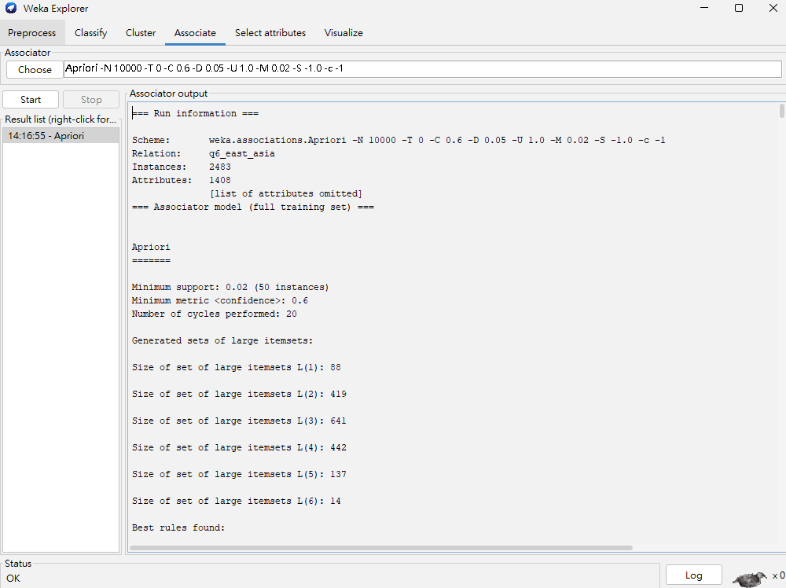
圖 6-3a　東亞組 Apriori 的 Weka 輸出

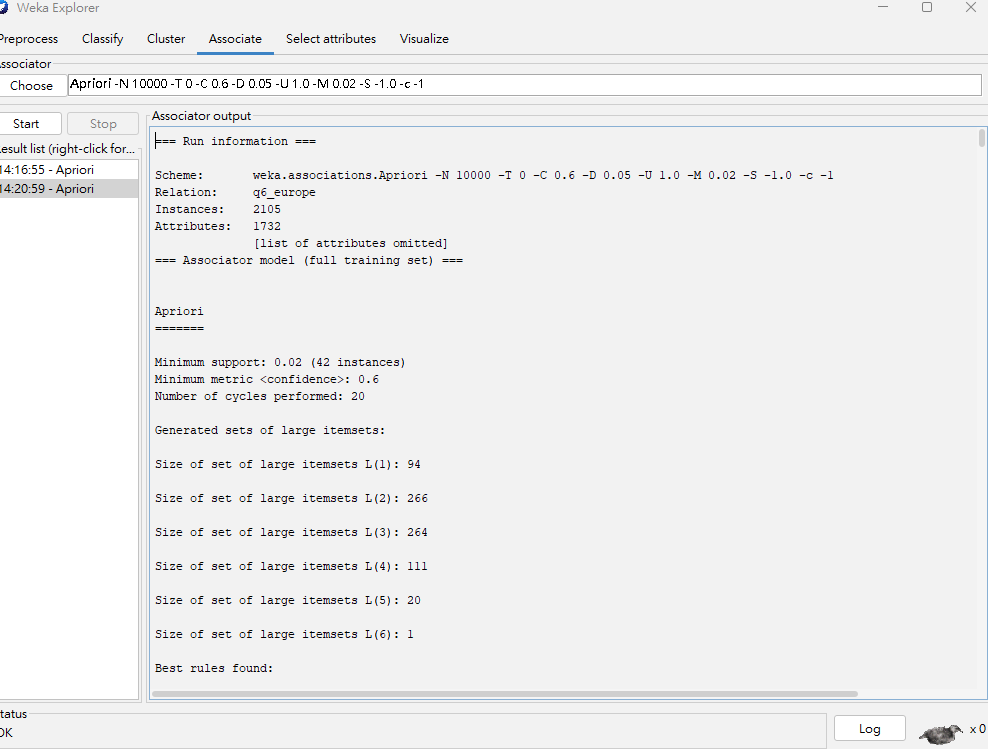
圖 6-3b　歐洲組 Apriori 的 Weka 輸出

Weka 輸出（節錄選用及解釋中引用的規則）：

```
東亞
    4. hoisin sauce=t sugar=t 58 ==> cuisine=Chinese 58    <conf:(1)> lift:(1.39) lev:(0.01) [16] conv:(16.28)
  169. hoisin sauce=t 176 ==> cuisine=Chinese 167    <conf:(0.95)> lift:(1.32) lev:(0.02) [40] conv:(4.94)
  388. chicken broth=t water=t cuisine=Chinese 57 ==> cornstarch=t 52    <conf:(0.91)> lift:(3.31) lev:(0.01) [36] conv:(6.88)
  397. mirin=t soy sauce=t 78 ==> cuisine=Japanese 71    <conf:(0.91)> lift:(3.24) lev:(0.02) [49] conv:(7.01)
  499. chicken broth=t water=t 60 ==> cornstarch=t 53    <conf:(0.88)> lift:(3.2) lev:(0.01) [36] conv:(5.43)
  562. mirin=t 122 ==> cuisine=Japanese 106    <conf:(0.87)> lift:(3.1) lev:(0.03) [71] conv:(5.16)
  620. sake=t 78 ==> cuisine=Japanese 66    <conf:(0.85)> lift:(3.01) lev:(0.02) [44] conv:(4.32)
 1034. soy sauce=t 1241 ==> cuisine=Chinese 909    <conf:(0.73)> lift:(1.02) lev:(0.01) [16] conv:(1.05)
 1062. soy sauce=t sugar=t 464 ==> cuisine=Chinese 337    <conf:(0.73)> lift:(1.01) lev:(0) [3] conv:(1.02)
 1086. sugar=t 849 ==> cuisine=Chinese 613    <conf:(0.72)> lift:(1) lev:(0) [2] conv:(1.01)
 ...（共 2,080 條）

歐洲
    1. sauerkraut=t 95 ==> cuisine=German 95    <conf:(1)> lift:(1.71) lev:(0.02) [39] conv:(39.44)
    2. caraway seed=t 92 ==> cuisine=German 92    <conf:(1)> lift:(1.71) lev:(0.02) [38] conv:(38.2)
    3. chorizo sausage=t 59 ==> cuisine=Spanish 59    <conf:(1)> lift:(2.41) lev:(0.02) [34] conv:(34.5)
    5. bay leaf=t garlic=t olive oil=t 52 ==> cuisine=Spanish 52    <conf:(1)> lift:(2.41) lev:(0.01) [30] conv:(30.41)
    8. saffron thread=t 47 ==> cuisine=Spanish 47    <conf:(1)> lift:(2.41) lev:(0.01) [27] conv:(27.49)
   14. chorizo sausage=t garlic=t 42 ==> cuisine=Spanish 42    <conf:(1)> lift:(2.41) lev:(0.01) [24] conv:(24.56)
   92. bay leaf=t olive oil=t 56 ==> garlic=t 52    <conf:(0.93)> lift:(3.25) lev:(0.02) [36] conv:(8)
  850. onion=t 694 ==> cuisine=German 422    <conf:(0.61)> lift:(1.04) lev:(0.01) [16] conv:(1.06)
  860. almond=t 86 ==> cuisine=German 52    <conf:(0.6)> lift:(1.03) lev:(0) [1] conv:(1.02)
 ...（共 875 條）
```

地區共用的食材：

表中的規則都是 ⇒ Chinese 或 ⇒ German，因為這兩國分別占東亞 71.9%、歐洲 58.5%
兩國都常用的食材（lift ≈ 1），⇒ 多數國那條的信賴度約等於它的比例，高於 0.6，會出現；⇒ 少數國那條的信賴度只有約 0.28（日式）或 0.42（西班牙），低於 0.6，不會出現
所以這裡看 lift 是否接近 1，lift ≈ 1 代表兩國用這個食材的比例差不多

| # | 組 | Weka 編號 | 規則 | 支持數 | 支持度 | 信賴度 | Lift |
|---|---|---|---|---|---|---|---|
| S1 | 東亞 | 1034 | soy sauce ⇒ cuisine=Chinese | 909 | 0.366 | 0.73 | 1.02 |
| S2 | 東亞 | 1086 | sugar ⇒ cuisine=Chinese | 613 | 0.247 | 0.72 | 1.00 |
| S3 | 東亞 | 1062 | soy sauce, sugar ⇒ cuisine=Chinese | 337 | 0.136 | 0.73 | 1.01 |
| S4 | 歐洲 | 850 | onion ⇒ cuisine=German | 422 | 0.200 | 0.61 | 1.04 |
| S5 | 歐洲 | 860 | almond ⇒ cuisine=German | 52 | 0.025 | 0.60 | 1.03 |

地區內的特色食材與組合：

| # | 組 | Weka 編號 | 規則 | 支持數 | 支持度 | 信賴度 | Lift |
|---|---|---|---|---|---|---|---|
| D1 | 東亞 | 397 | mirin, soy sauce ⇒ cuisine=Japanese | 71 | 0.029 | 0.91 | 3.24 |
| D2 | 東亞 | 620 | sake ⇒ cuisine=Japanese | 66 | 0.027 | 0.85 | 3.01 |
| D3 | 東亞 | 4 | hoisin sauce, sugar ⇒ cuisine=Chinese | 58 | 0.023 | 1.00 | 1.39 |
| D4 | 東亞 | 499 | chicken broth, water ⇒ cornstarch | 53 | 0.021 | 0.88 | 3.20 |
| D5 | 歐洲 | 1 | sauerkraut ⇒ cuisine=German | 95 | 0.045 | 1.00 | 1.71 |
| D6 | 歐洲 | 2 | caraway seed ⇒ cuisine=German | 92 | 0.044 | 1.00 | 1.71 |
| D7 | 歐洲 | 8 | saffron thread ⇒ cuisine=Spanish | 47 | 0.022 | 1.00 | 2.41 |
| D8 | 歐洲 | 14 | chorizo sausage, garlic ⇒ cuisine=Spanish | 42 | 0.020 | 1.00 | 2.41 |
| D9 | 歐洲 | 92 | bay leaf, olive oil ⇒ garlic | 52 | 0.025 | 0.93 | 3.25 |

註：D4、D9 是「食材 ⇒ 食材」的規則，本身沒有分辨國家；要對照 #388（D4 限定中式時的版本）和 #5（D9 的三種食材全部是西班牙菜）才看得出屬於哪一國

**效果解釋**

結論是「⇒ 某國」的規則，lift 最高只能到 1 ÷ 該國比例：⇒ Chinese 1.39、⇒ Japanese 3.56、⇒ German 1.71、⇒ Spanish 2.41
所以比較時要看 lift 離 1 和離上限各有多近，不能直接比 lift 大小
下面各國的使用比例是用 Weka 的計數算出來的，例如醬油共 1,241 道、其中中式 909 道，日式就是 332 道

*地區共用的食材*

1. **soy sauce**（S1）：中式 1,786 道裡有 909 道用醬油（50.9%），日式 697 道裡有 332 道（47.6%），比例幾乎一樣，lift 1.02
   醬油出現在東亞組一半的食譜裡，但本身分辨不了國家，要搭配 mirin 才會偏向日式（D1）
2. **sugar**（S2）：中式 34.3%、日式 33.9%，lift 1.00，是兩國用法最接近的食材
3. **soy sauce + sugar**（S3）：兩者一起用時 lift 也只有 1.01，「醬油加糖」的調味兩國都很常見
4. **onion**（S4）：德式 1,231 道裡有 422 道（34.3%），西班牙菜 874 道裡有 272 道（31.1%），lift 1.04
5. **almond**（S5）：德式 4.2%、西班牙菜 3.9%，lift 1.03
   歐洲組因為只看得到 ⇒ German 這一邊，相似度只能從這兩條看

*補充：地區內的特色食材與組合*

1. **mirin + soy sauce ⇒ 日式**（D1）：同時用味醂和醬油的 78 道裡，71 道是日式；日式只占 28.1%，所以 lift 有 3.24
   單獨用 mirin 的信賴度是 0.87（#562），加上 soy sauce 升到 0.91
2. **sake ⇒ 日式**（D2）：用清酒的 78 道裡有 66 道是日式（0.85）
   東亞組的 2,080 條規則裡，⇒ Japanese 只有 3 條（#397、#562、#620），全都和味醂或清酒有關
3. **hoisin sauce + sugar ⇒ 中式**（D3）：58 道全是中式，信賴度 1，lift 1.39 已經是上限；單獨用海鮮醬的信賴度是 0.95（#169）
   中式的規則 lift 大多在 1.3 左右，是中式比例高造成的，不代表關聯弱
4. **chicken broth + water ⇒ cornstarch**（D4）：食材 ⇒ 食材的規則
   有雞高湯又加水的 60 道裡，53 道用了玉米澱粉；玉米澱粉整體只出現在 27.6% 的食譜，lift 3.20
   限定中式時（#388）信賴度是 0.91，這個組合主要出現在中式食譜
5. **sauerkraut、caraway seed ⇒ 德式**（D5、D6）：德國酸菜（95 道）和葛縷子（92 道）全部出現在德式食譜，信賴度 1，lift 1.71 已經是上限，也是歐洲組支持數最高的兩條規則
6. **saffron thread、chorizo sausage + garlic ⇒ 西班牙菜**（D7、D8）：番紅花 47 道、西班牙香腸加大蒜 42 道，全部是西班牙菜，lift 2.41 也是上限；單獨用 chorizo sausage 時同樣是 59/59（#3）
   這兩條的支持數都低於 63，support 0.03 時不會出現
7. **bay leaf + olive oil ⇒ garlic**（D9）：同時用月桂葉和橄欖油的 56 道裡，52 道也用了大蒜（0.93）；大蒜整體只出現在 28.6% 的食譜，lift 3.25
   而 bay leaf + garlic + olive oil 的 52 道全部是西班牙菜（#5），這是西班牙菜的基本調味組合

*小結*：

- **東亞**：醬油、糖和「醬油加糖」是中、日共用的基礎調味，兩國的使用比例幾乎相同（lift 1.00～1.02）
  能分辨兩國的只有味醂、清酒、海鮮醬等少數食材
- **歐洲**：洋蔥、杏仁在德、西兩國的使用比例相近（lift 1.03～1.04），但受 confidence 門檻限制，只能從 ⇒ German 這一邊觀察
  德國酸菜、葛縷子、番紅花、西班牙香腸則只出現在其中一國
- 同一地區的食譜共用支持數很高的基礎調味，國家之間的差異集中在少數支持數較低的特色食材上，這些規則的信賴度大多是 1、lift 達到上限

